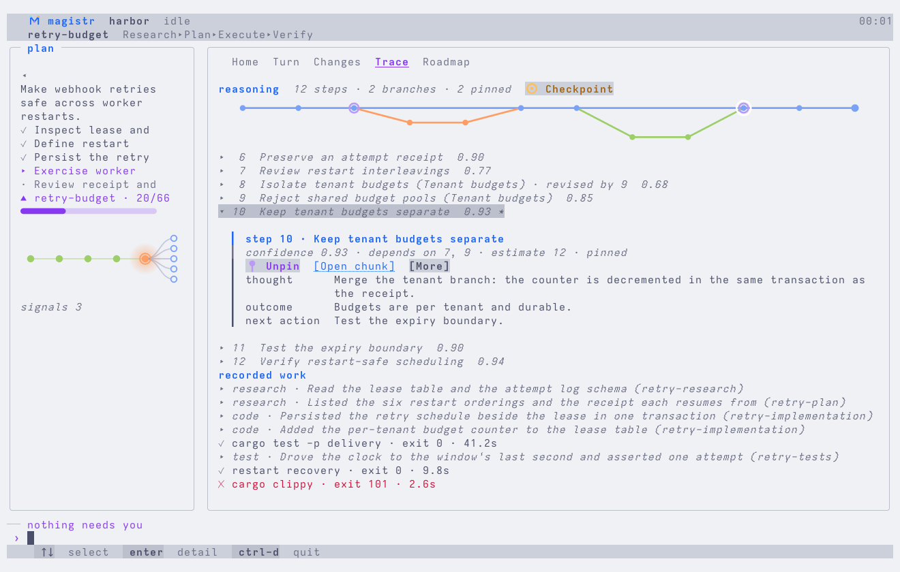

# Magistr

**Roadmap and workflow management for coding agents.**

[Website](https://magistr.dev) · [Documentation](https://magistr.dev/docs/installation) · [Architecture](docs/architecture/overview.md) · [Issues](https://github.com/AlrikOlson/magistr/issues) · [Repository](https://github.com/AlrikOlson/magistr)

> **Early development release · v0.1.0**
>
> Magistr is an early release and still changing. Review the work it performs before using it on an important checkout.

Magistr keeps a project's roadmap, runs one focused work item at a time, and records the reasoning, the changes and the checks along the way — in the project, not in a chat transcript.

<picture>
  <source media="(prefers-color-scheme: dark)" srcset="apps/website/public/screenshots/terminal-roadmap-dark.png" />
  
</picture>

*The Roadmap tab of a sample project, captured from the terminal interface ([full size, dark](apps/website/public/screenshots/terminal-roadmap-dark.png) · [light](apps/website/public/screenshots/terminal-roadmap-light.png)).*

## Install

Requires Git and Rust 1.95 or later. There is no registry package yet.

```sh
git clone https://github.com/AlrikOlson/magistr.git
cd magistr
cargo install --locked --path crates/magistr-cli
magistr --version
```

## Initialize a project

In the project you want to work on:

```sh
magistr init .
magistr
```

`magistr init` detects the stack and writes `.magistr/project.json` — the commands Magistr runs as quality gates and the roadmap settings — plus the agent setup. `magistr` opens the terminal interface.

## Connect an agent

```sh
magistr init . --agent codex --yes
./.codex/run
```

For Claude Code, run `magistr init . --yes`, then launch `claude` in the project. The setup installs the workflow commands the agent uses: `/next` (Codex: `$next`) carries one ready work item through the workflow and stops, `/roadmap-refresh` reshapes the roadmap without implementing anything, and `/validate` runs the configured checks.

## Inspect the roadmap

The Roadmap tab draws the work items as a dependency graph: shipped work in green, work that still waits on something hollow, work that is ready to claim filled, and the item in progress ringed. Selecting an item lights everything it stands on and everything that stands on it, and opens its acceptance criteria and dependencies.

## Run one work item

```sh
magistr next
```

Runs the next ready work item — the most urgent pending item whose dependencies are done — in one session and records what happened. `magistr next-loop` continues through fresh agent sessions, one item per session.

<picture>
  <source media="(prefers-color-scheme: dark)" srcset="apps/website/public/screenshots/terminal-trace-dark.png" />
  
</picture>

*The Trace tab: the session's reasoning steps as a graph, the selected step's card, and the recorded actions and checks ([full size, dark](apps/website/public/screenshots/terminal-trace-dark.png) · [light](apps/website/public/screenshots/terminal-trace-light.png)).*

## Verification

An item is done when its acceptance criteria hold and the configured checks pass. Each check runs with its real command and is recorded with its exit code and duration; a failed required check keeps the item from completing.

## Current limitations

- The terminal interface and the local CLI are the supported path; the desktop interface is experimental and is not part of the release.
- Agent runtimes (Claude Code, Codex, Copilot) and API providers are installed and authenticated separately; Magistr does not sandbox them.
- No crates.io package yet; install from source.

## Development

```sh
cargo fmt
cargo check --workspace --all-targets
cargo nextest run --workspace
cargo clippy --workspace --all-targets -- -D warnings
```

Website checks live in `apps/website` (`npm ci && npm test`). Read the [documentation index](docs/index.md), the [development guide](docs/development.md), the [contributing guide](CONTRIBUTING.md) and the [MIT license](LICENSE).
