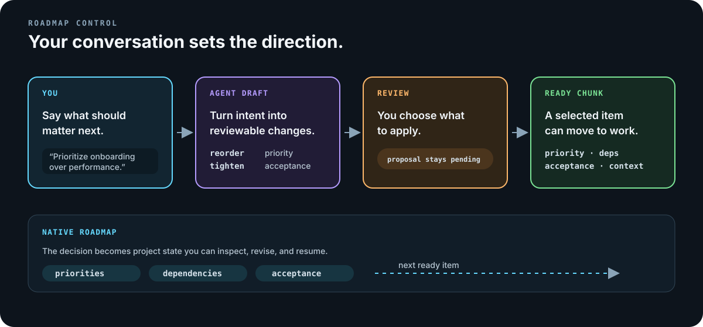
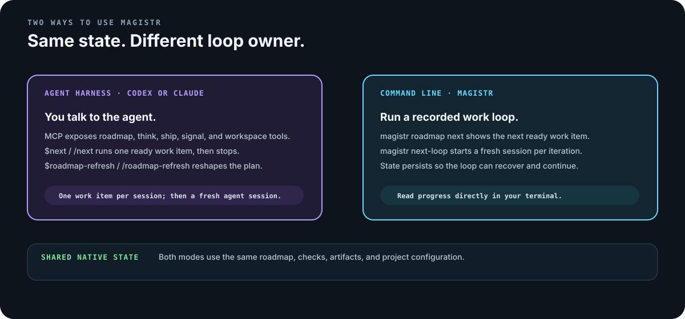
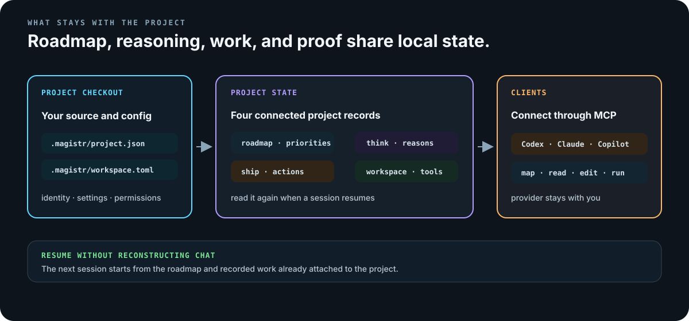
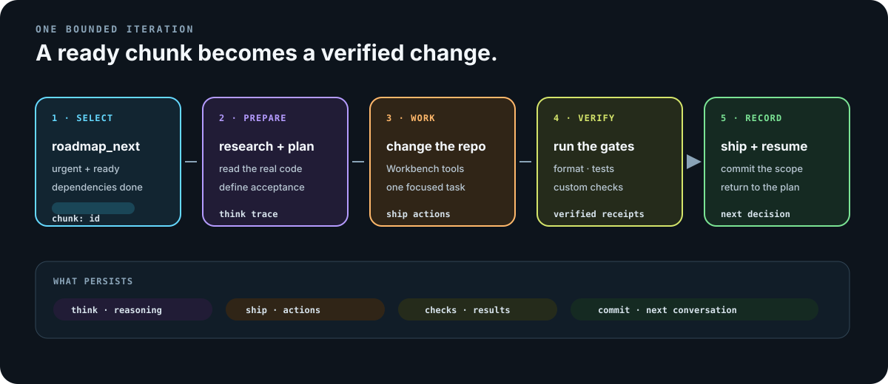

# Magistr

**A roadmap and workflow layer for coding agents.**

Magistr gives an agent a project roadmap it can read, a workflow that turns one ready item into one verified change, and a local record of the decisions and checks you will want when you return. You steer the direction by talking to the agent. Magistr keeps the plan explicit and the work bounded.

> **Early development release · v0.1.0**
>
> Magistr is being built in public. Commands, configuration, and supported surfaces can change. Use it on a project where you can review the agent's work.

## How you use it

You use Magistr in a conversation with your coding agent:

1. **Talk about the next outcome.** Ask for a roadmap refresh, a new priority, sharper acceptance criteria, or a follow-up chunk.
2. **Review the proposed direction.** The agent can draft the change and explain its dependencies. A re-prioritization is a proposal until you choose to apply it.
3. **Run one ready chunk.** The workflow selects the most urgent unblocked item and carries it through research, planning, implementation, verification, and a scoped commit.
4. **Return with context intact.** A later session can read the native roadmap, reasoning, tasks, checks, and artifacts instead of rebuilding the plan from chat history.



For example:

```text
I want onboarding ahead of performance for the next month. Refresh the roadmap
around that outcome, show the proposed priority and dependency changes, and
wait for me to decide what to apply. Then tell me which chunk is ready.
```

This is the important interaction: your conversation drives the roadmap. The agent helps shape and explain it; it does not silently decide what the project should become.

## Two modes

The same native project state is available through two different entry points.

### Agent harness: Codex or Claude

`magistr init` creates the project instructions, skills, configuration, and local MCP connection. The agent then calls Magistr's roadmap, reasoning, execution, signal, and workspace tools.

- `$next` in Codex or `/next` in Claude runs one ready chunk.
- `$roadmap-refresh` or `/roadmap-refresh` researches and reshapes the roadmap without implementing code.
- `$next-loop` is a bounded fresh-session handoff: finish one chunk, write the handoff, stop, and resume the bound only in a new Codex or Claude session. It must not chain chunks in the same context.
- `$validate` runs the project's configured checks without selecting new work.

The harness path is agent-session driven. One chunk belongs to one context; native roadmap and ship receipts carry the work into the next session.

### Native TUI

Run `magistr` in a project to open the terminal cockpit. The Home view shows the project and next action; the cockpit shows phases, the live task plan, agent output, permissions, roadmap state, and checks.

`magistr next` runs one iteration. `magistr next-loop` starts the host-owned loop, persists its checkpoint between iterations, and can recover after an interruption. The TUI is the interactive mode where Magistr itself owns the live loop; the harness path above remains driven by the agent session.



## What persists

Magistr keeps four connected records for the project:

| Record | What it holds |
| --- | --- |
| **Roadmap** | Chunks with priorities, dependencies, descriptions, acceptance criteria, blockers, and ready status. |
| **Think** | Research, decisions, hypotheses, and the reasoning that motivated a roadmap or implementation choice. |
| **Ship** | The active objective, task plan, actions, quality gates, artifacts, and final status for one chunk. |
| **Workspace** | The project source accessed through Workbench's `map`, `search`, `read`, `edit`, `files`, `undo`, `script`, and declared-command `run` tools. |

The roadmap is native state, not a markdown file. `roadmap_next` chooses the most urgent pending chunk whose dependencies are done. `roadmap_reprioritize` records a suggested order and reason; it leaves the real priority unchanged until you explicitly apply it.



## One iteration, end to end

A `/next` or `magistr next` iteration has a clear boundary:

- select one ready roadmap chunk;
- research the code and plan the work;
- make the change through the project workspace;
- run the formatter, tests, linter, and required custom gates;
- record command-backed results and artifacts;
- commit the scoped change and return to the roadmap.



## Install

Magistr is source-first in v0.1. You need Git, Rust 1.95 or later, and a supported coding-agent runtime installed and authenticated separately.

```sh
git clone https://github.com/AlrikOlson/magistr.git
cd magistr
cargo install --locked --path crates/magistr-cli
magistr --version
```

Set up a project for an agent harness:

```sh
cd ~/src/my-project
magistr init . --agent codex --yes
./.codex/run
```

For Claude Code, initialize the project and launch Claude normally:

```sh
cd ~/src/my-project
magistr init . --yes
claude
```

To use the native cockpit:

```sh
cd ~/src/my-project
magistr
```

Initialization detects the stack and writes project instructions, workflow skills, `.magistr/project.json`, and the MCP connection. Read the [Codex integration guide](docs/reference/codex.md) for launcher, configuration, diagnostics, and removal details. Cursor and Copilot setup targets are available when those runtimes are installed.

## Commands you will use

| When you want to… | Use |
| --- | --- |
| inspect the roadmap | `roadmap_status` or `magistr roadmap` |
| refresh priorities or discover follow-up work | `$roadmap-refresh` / `/roadmap-refresh` |
| implement the next ready chunk | `$next` / `/next`, or `magistr next` |
| run a bounded host-owned loop | `magistr next-loop` |
| run configured checks only | `$validate` / `/validate`, or `magistr validate` |
| recover execution state | `ship_status` |

The generated project skills also include `$next-loop`, `$roadmap`, `$signals`, `$craft`, `$init`, and `$workbench-routing`. Codex uses the `$` form; Claude Code uses the `/` form.

## Boundaries

- This is a local, source-first development release. There is no crates.io install path yet.
- Your agent runtime, provider credentials, checkout, and operating-system permissions remain yours. Magistr's permission prompts guide the workflow; they are not an OS sandbox.
- Native roadmap state is authoritative. The default project policy keeps `ROADMAP.md` and `ROADMAP.json` out of the workflow.
- The terminal cockpit is the primary supported interface. The desktop interface is experimental and is not shipped from `main`.
- Live provider sessions still require the selected runtime or API credentials. Ollama requires a reachable local Ollama service.

See the [release inventory](docs/release-inventory.md) for the shipped surface and prerequisites. The [documentation index](docs/index.md), [development guide](docs/development.md), and [architecture overview](docs/architecture/overview.md) cover contributor and implementation details.

## Feedback and contributing

Try Magistr on a disposable or well-reviewed project and open a focused [issue](https://github.com/AlrikOlson/magistr/issues) with the command, provider, and project shape involved. Read [CONTRIBUTING.md](CONTRIBUTING.md), [SECURITY.md](SECURITY.md), and [CODE_OF_CONDUCT.md](CODE_OF_CONDUCT.md) before contributing or reporting.

## License

Magistr is available under the [MIT license](LICENSE). Bundled fonts retain their [own notices](crates/magistr-cockpit/fonts).

