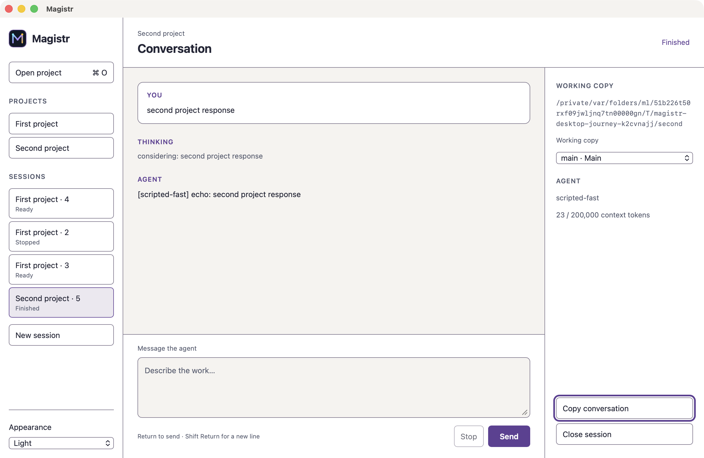

# Magistr

**Build a project with Magistr. Work with the coding agent you prefer.**

[Explore Magistr](https://magistr.dev) · [Start building](https://magistr.dev/docs/workflow) · [Install](docs/getting-started.md)

I want to take on projects that won't fit in one chat. I want to work out the
big picture, understand the choices, and let my agent build useful pieces of it.
Then I want to try the result, change my mind about parts, and keep going.

That's how I use Magistr. It keeps the roadmap, recorded reasoning, work chunks
and checks with the project, so the next session has something useful to read.

Magistr is a source preview. It hasn't been publicly released; npm and Cargo
registry packages aren't available yet.

## How the work fits together

- **Plan the project.** Keep priorities, dependencies and acceptance criteria
  on a roadmap you can revise as you learn.
- **Keep the reasoning.** Record investigations, compare approaches, and
  connect the decision to the evidence and work it informs.
- **Finish useful chunks.** Work through one ready piece, or give a longer run
  a focus and a limit. Keep its tasks, actions and finished changes together.
- **Check what you built.** Record actual command results and written reviews.
  Keep failures visible and check whether earlier results still apply.
- **Keep going.** Save feedback, update the plan, and let a fresh session pick
  up the unfinished work.

[Explore real records and a complete recorded build](https://magistr.dev/#product).
The inbox example includes its original source, failed checks, screen review
and the finished app.

## Try it in your project

The current CLI preview targets Apple Silicon macOS 15 or later. With repository
access, Rust 1.95 or later, Git and the macOS command-line build tools:

```sh
git clone https://github.com/AlrikOlson/magistr.git
cd magistr
cargo install --locked --path crates/magistr-cli
magistr --version
```

Install and sign in to your agent separately. In the project you want to build,
run `magistr init .`. Choose your agents and review the proposed files and check
commands. Setup connects the project and gives you a planning prompt.

Open Codex with `./.codex/run`, or start `claude` for Claude Code.
Other MCP agents can connect too. [Installation](docs/getting-started.md)
covers setup, upgrades and removal.

## Start with what you want to make

> Read the code and the saved plan. What's working, what's unfinished, and
> what would make the biggest difference? Explain what you find.

Research what's uncertain. Turn the useful work into roadmap chunks. When you're
ready, use `$next` in Codex or `/next` in Claude Code to finish one chunk,
including the relevant checks and a commit.

For a longer run with a fresh agent session for each chunk:

```sh
magistr next-loop --agent codex --max-iterations 5
```

Use `--agent claude` for Claude Code or add `--track` with a track from your
roadmap. Inside a chat, the `next-loop` skill finishes one chunk and prepares
the next session's handoff.

Try the result. Give concrete feedback. Tell the agent how you want commits,
pushes and publishing handled.

## Learn the workflow

[Working with Magistr](https://magistr.dev/docs/workflow) ·
[Planning](https://magistr.dev/docs/roadmap) ·
[Reasoning](https://magistr.dev/docs/reasoning) ·
[Chunks](https://magistr.dev/docs/chunks) ·
[Checks](https://magistr.dev/docs/verification) ·
[Saved work and sessions](https://magistr.dev/docs/concepts)

Project records carry over between connected agents. Their chat transcripts
and model settings stay separate. Magistr's source tools can check edits
against the files the agent read and keep a change journal; tests, review and
Git still matter.

## Desktop preview

<picture>
  <source media="(prefers-color-scheme: dark)" srcset="apps/website/public/screenshots/desktop-dark.png" />
  
</picture>

Open **Launch Magistr.command** on macOS or **Launch Magistr.cmd** on Windows
in this checkout. You'll need Rust 1.95+, Node.js 22+, and the
[platform build prerequisites](https://v2.tauri.app/start/prerequisites/).

The preview opens projects and conversations, handles permission requests,
keeps drafts, and shows the current work plan. Use the connected agent or CLI
for the full planning and change-review workflow.

Development packages are available from successful runs of the
[desktop apps workflow](https://github.com/AlrikOlson/magistr/actions/workflows/desktop-apps.yml).
They are not publicly signed or notarized.

## Development

[Development guide](docs/development.md) · [Architecture](docs/architecture/overview.md) · [Contributing](CONTRIBUTING.md) · [MIT license](LICENSE)

Agent runtimes are installed and authenticated separately. Magistr does not
sandbox their operating-system access; choose permissions that fit your project.
