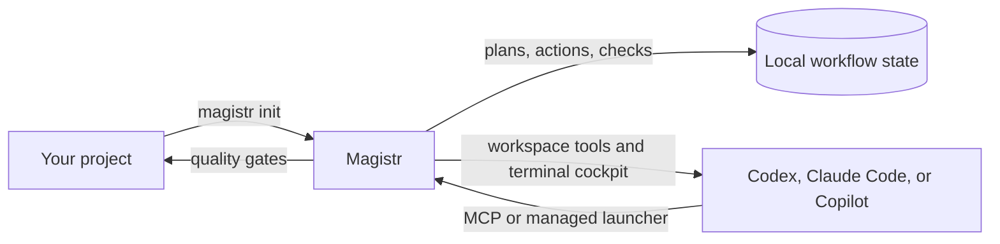

# Magistr

Magistr gives a coding agent a durable way to work in a real project. It detects
the project stack, creates the agent setup, serves native workspace and workflow
tools, and records plans, actions, and quality checks so a session can be
reviewed instead of disappearing into chat history.

## How it fits together



You point Magistr at a project, choose an agent integration, and let the agent
use the admitted tools. Magistr keeps workflow state in the project so you can
inspect the roadmap, execution plan, recorded evidence, and gate results.

## Quickstart

You need Git, Rust 1.95 or later, and a supported coding-agent runtime installed
and authenticated separately. API providers and local services are also your
responsibility; see [provider prerequisites](docs/getting-started.md#configure-a-project).

Install the CLI from source:

```sh
git clone https://github.com/AlrikOlson/magistr.git
cd magistr
cargo install --locked --path crates/magistr-cli
magistr --version
```

Initialize a disposable project for Codex:

```sh
mkdir -p "$HOME/src/magistr-demo"
cd "$HOME/src/magistr-demo"
magistr init . --agent codex --yes
./.codex/run
```

The launcher starts the installed Codex CLI. For the default Claude setup, run
`magistr init . --yes` and open the project with Claude Code. Cursor and Copilot
scaffold targets can be selected with `--agent` when they are installed.

From the agent session:

- Use `$next` to implement one ready roadmap item with a recorded plan and
  verification.
- Use `$next-loop` only when you want several bounded iterations.
- Use `$validate` to run the project's standard and required custom gates.

The [getting started guide](docs/getting-started.md) explains refresh, removal,
configuration precedence, and provider-specific setup.

## Supported surfaces

The v0.1.0 CLI provides project setup and detection (`init`, `detect`), workflow
commands (`validate`, `run`, `next`, and `next-loop`), configuration and
diagnostics, plugin and preset management, shell completions, and man-page
generation. It also launches:

- **MCP** with `magistr mcp-launch`, including the native workflow and workspace
  tool families.
- **Terminal cockpit** for live phases, task progress, output, and session
  controls.
- **Workspace tools** for bounded `search`, `map`, `read`, `edit`, `files`,
  `undo`, `script`, and admitted-command `run` operations.

Agent setup targets include Claude Code, Codex, and Copilot. Codex uses the
managed `.codex/run` launcher. Provider adapters cover OpenAI, Gemini, and
Ollama; authentication and credentials remain with the caller.

## Current status and boundaries

Magistr v0.1.0 is a **development preview**. It is useful for an informed
developer who can run Rust tooling and an agent CLI; it is not a hosted service
or a supported beta release.

- The desktop interface is experimental and maintained on the
  [`gui2` branch](https://github.com/AlrikOlson/magistr/tree/gui2). No desktop
  binary ships from `main`.
- The peer protocol is compatibility-only. Runtime authentication, transport,
  metering, persistence, and dispatch are not wired into the CLI or interfaces.
- Live provider sessions require the selected runtime or API credentials. Tests
  and adapters do not imply a hosted provider or a live service.
- Permission prompts are workflow controls, not an operating-system sandbox.
  Agent processes retain their normal file, process, and network permissions.
- Roadmap export is disabled by policy (`roadmap_exports = false`). Native
  roadmap state is authoritative; Magistr does not generate `ROADMAP.md` or
  `ROADMAP.json`.

Release archives are host-specific. The package script builds the current host
target and emits a `magistr-<version>-<target>.tar.gz` archive with bash, zsh,
and fish completions, generated man pages, the MIT license, bundled font notices,
and a matching SHA-256 file. Do not use an archive built for a different host.

## Release readiness

Before announcing a public release, follow the [release inventory and checklist](docs/release-inventory.md):

- [ ] Install from a clean checkout with `cargo install --locked --path crates/magistr-cli`;
  verify `magistr --version` and `magistr --help`.
- [ ] Build `./scripts/package-release.sh` on each target platform and inspect the
  binary, completions, man pages, `LICENSE`, and both font notices.
- [ ] Verify the archive with `sha256sum -c <archive>.sha256` or
  `shasum -a 256 -c <archive>.sha256`.
- [ ] Walk through `magistr init . --agent codex --yes`, `./.codex/run`, and one
  recorded `magistr validate` or `magistr next` cycle in a disposable project.
- [ ] Confirm the [repository](https://github.com/AlrikOlson/magistr), [releases](https://github.com/AlrikOlson/magistr/releases),
  and [issues](https://github.com/AlrikOlson/magistr/issues) links are publicly
  reachable without authentication before publication. The configured links
  currently return 404 to anonymous fetches, so the preview remains unpublished.
- [ ] Publish release notes and website changelog with the same SemVer tag as the
  CLI, carrying unreleased work into the next version.

## Contributing and deeper docs

- [Getting started](docs/getting-started.md): build, configure, and run an agent.
- [Development guide](docs/development.md): checks, tests, agent safety, and release
  packaging.
- [Architecture overview](docs/architecture/overview.md): crate boundaries and
  system contracts.
- [Documentation index](docs/index.md): terminal, desktop, sessions, authority,
  peers, and reference guides.
- [Canonical release inventory](docs/release-inventory.md): shipped surfaces,
  prerequisites, package contents, notices, and publication checks.

Please open a focused issue for bugs or support questions once the repository's
issue tracker is public. Until then, the repository's configured
[issues URL](https://github.com/AlrikOlson/magistr/issues) is the intended support
path.

## License

Magistr is available under the [MIT license](LICENSE). Bundled fonts retain their
[own notices](crates/magistr-cockpit/fonts).
