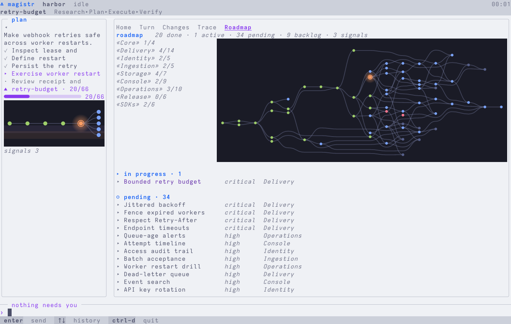

# Magistr

**Roadmap and workflow management for coding agents.**

[Website](https://magistr.dev) · [Documentation](https://magistr.dev/docs) · [Repository](https://github.com/AlrikOlson/magistr)

> **Early development release · v0.1.0**
>
> Magistr is an early release and still changing. Review the work it performs before using it on an important checkout.

Magistr keeps a roadmap, runs one focused work item, and records the decisions, checks, and files changed along the way.

## Install

Requires Git and Rust 1.95 or later.

```sh
git clone https://github.com/AlrikOlson/magistr.git
cd magistr
cargo install --locked --path crates/magistr-cli
magistr --version
```

## Try it

In the project you want to work on:

```sh
magistr init .
magistr
```

For a Codex project setup:

```sh
magistr init . --agent codex --yes
./.codex/run
```

For Claude Code, run `magistr init . --yes`, then launch `claude`.

## The terminal interface

Magistr’s terminal interface keeps the roadmap, current work, and verification in one view. This capture uses a realistic sample project:

<picture>
  <source media="(prefers-color-scheme: dark)" srcset="apps/website/public/screenshots/tui2-roadmap-dark.png" />
  
</picture>

Run `magistr next` for one ready work item or `magistr next-loop` to continue through fresh agent sessions.

## Status

Magistr v0.1.0 is an early, source-first release.

- The terminal interface and local CLI are the supported path.
- The desktop interface is experimental.
- There is no crates.io package yet.

## Development

```sh
cargo fmt
cargo check --workspace --all-targets
cargo nextest run --workspace
cargo clippy --workspace --all-targets -- -D warnings
```

Website checks live in `apps/website`: `npm ci && npm test`.

Read the [documentation index](docs/index.md), [architecture overview](docs/architecture/overview.md), [contributing guide](CONTRIBUTING.md), and [MIT license](LICENSE).

