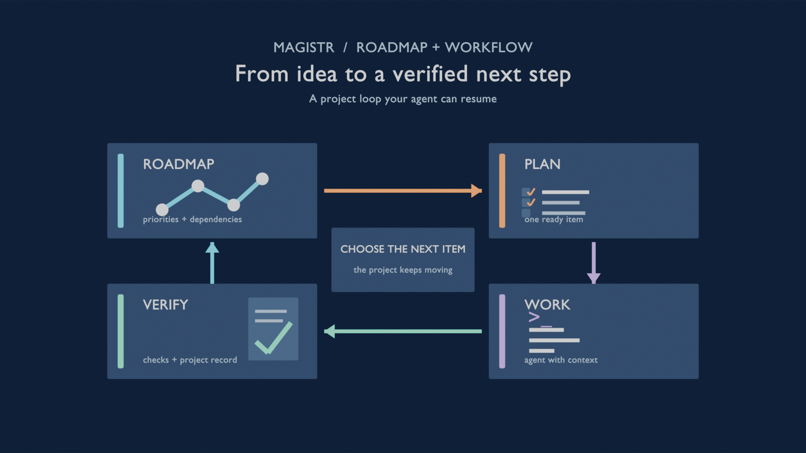
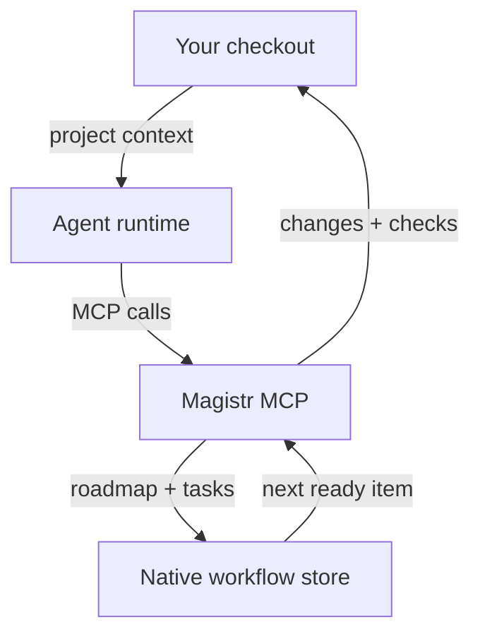
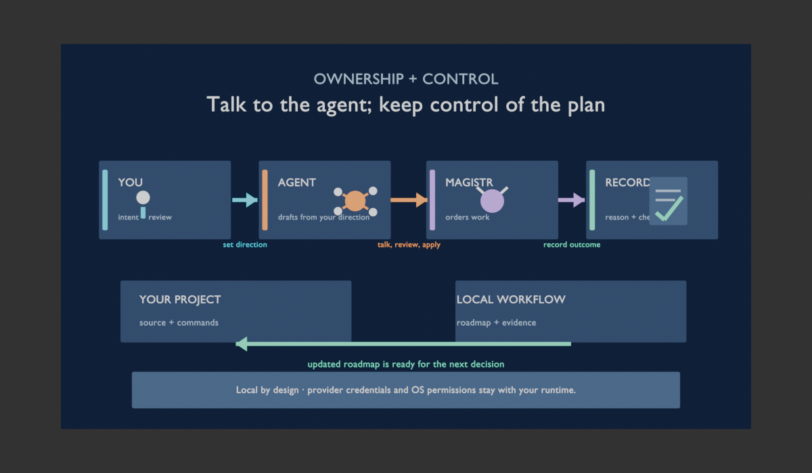
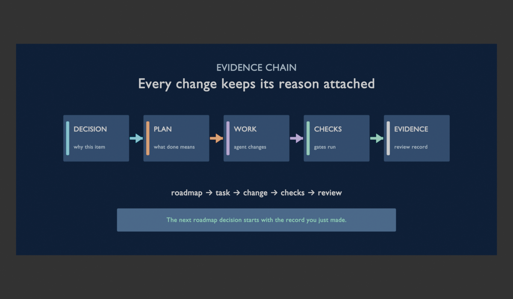
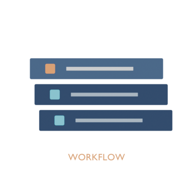

# Magistr

**Roadmap and workflow management for coding agents.**

Magistr helps you turn a project's ideas into an ordered roadmap, give an agent one clear next task, and keep the plan, work, and checks together as the project changes.

> **Early development release · v0.1.0**
>
> Magistr is useful today, but it is still being built in public. Expect changing commands and configuration, and use it on projects where you can review the agent's work.

## The loop

You decide what matters. Magistr keeps the roadmap visible, the agent works one planned item at a time, and the result comes back with checks you can inspect. The next decision is ready when you are.




*Roadmap → plan → work → verify → choose the next item.*

## How the pieces fit

The roadmap is the shared source of truth. Magistr keeps the boundary between your checkout, the agent runtime, and its own recorded workflow explicit.





The evidence chain makes a change reviewable from its reason to its result:




Mermaid source stays beside each visual so the model remains readable in a terminal, diff, or screen reader.

## Why people use it

###  A roadmap an agent can follow

Keep goals, priorities, dependencies, and acceptance criteria in one project roadmap. Magistr can research and reshape the roadmap, then select a ready item that has enough context to implement. You can see what is ready, what is blocked, and why.

###  A workflow you can resume

Each iteration has a small plan, a focused task, and recorded checks. The state stays with the project, so a new session can continue from the roadmap instead of reconstructing decisions from chat history.

###  Proof attached to the work

The agent runs the project's configured formatter, tests, linter, and custom checks. Magistr records the result against the task, giving you a reviewable trail from roadmap item to change to verification.

## Try it

### 1. Install Magistr

You need Git, Rust 1.95 or later, and a supported coding-agent CLI installed and authenticated separately. v0.1 is source-first; crates.io publication is not available yet.

> **Permission and privacy boundary:** Magistr runs locally and stores roadmap state in the project workflow store. An agent keeps the normal operating-system permissions of the runtime you launch, and provider credentials stay with that runtime. Review generated files and commands before using Magistr on a sensitive checkout.

```sh
git clone https://github.com/AlrikOlson/magistr.git
cd magistr
cargo install --locked --path crates/magistr-cli
magistr --version
```

Cargo installs the binary in its usual directory, commonly `~/.cargo/bin`. Add that directory to `PATH` if your shell does not find `magistr`.

### 2. Set up a project

Run this from the project you want an agent to work on:

```sh
cd ~/src/my-project
magistr init . --agent codex --yes
./.codex/run
```

This creates project instructions, a local workflow configuration, and the MCP connection that lets Codex use Magistr's roadmap and workspace tools. Start a new Codex session after setup.

For Claude Code, use the same project setup without the Codex launcher:

```sh
cd ~/src/my-project
magistr init . --yes
claude
```

The generated instructions teach the agent how to use the project roadmap and workflow. See the [Codex integration guide](docs/reference/codex.md) for launcher details. Cursor and Copilot scaffolds can be selected with `--agent` when those tools are installed.

### 3. Make a first roadmap decision

Ask the agent to create or review a small roadmap for the project, with ordered items and clear acceptance criteria. Then choose a ready item:

```text
Create a small roadmap for this project. Keep the first three items concrete,
ordered, and independently verifiable. Then show me which item is ready first.
```

When an item is ready, use:

- `$next` to implement one item with a plan and recorded verification.
- `$next-loop` to work through a bounded number of ready items.
- `$validate` to run the project's configured checks without starting new work.

Claude Code uses the same skills with a `/` prefix, such as `/next`.

## What Magistr provides

- **Roadmap management:** capture goals, research decisions, priorities, dependencies, and ready work in the project's native roadmap.
- **Workflow management:** plan, execute, verify, and close one focused item while preserving the surrounding roadmap.
- **Project-aware tools:** search, map, read, edit, move, undo, and run declared project commands through the agent's MCP connection.
- **A terminal cockpit:** watch phases, task progress, output, and session controls while work is running.
- **Provider connections:** use Codex, Claude Code, or Copilot as the agent runtime. OpenAI and Gemini API adapters, plus Ollama for local models, are available where configured.

Magistr is a local tool. Your agent runtime and provider credentials remain yours; Magistr does not host a model or provide a hosted project service.

## Current boundaries

This release is deliberately honest about its edges:

- The terminal workflow is the primary experience. The desktop interface is experimental and is not shipped as the main binary.
- Provider credentials and local services are prerequisites for live sessions. Ollama must already be running when you choose it.
- Permission prompts guide the workflow; they do not sandbox the agent's normal operating-system access.
- Roadmap state stays in the project workflow store. With the default policy, Magistr does not export `ROADMAP.md` or `ROADMAP.json`.
- Commands, provider adapters, and generated project files may change during the v0.1 development cycle.

For the detailed surface inventory and package notes, see the [release inventory](docs/release-inventory.md). For architecture and contributor setup, see the [documentation index](docs/index.md), [development guide](docs/development.md), and [architecture overview](docs/architecture/overview.md).

## Feedback and contributing

Try Magistr on a disposable or well-reviewed project and open a focused [issue](https://github.com/AlrikOlson/magistr/issues) with the command, provider, and project shape involved. The [development guide](docs/development.md) explains the checks used before changes land.

Read [CONTRIBUTING.md](CONTRIBUTING.md), [SECURITY.md](SECURITY.md), and [CODE_OF_CONDUCT.md](CODE_OF_CONDUCT.md) before contributing or reporting.

## License

Magistr is available under the [MIT license](LICENSE). Bundled fonts retain their [own notices](crates/magistr-cockpit/fonts).

