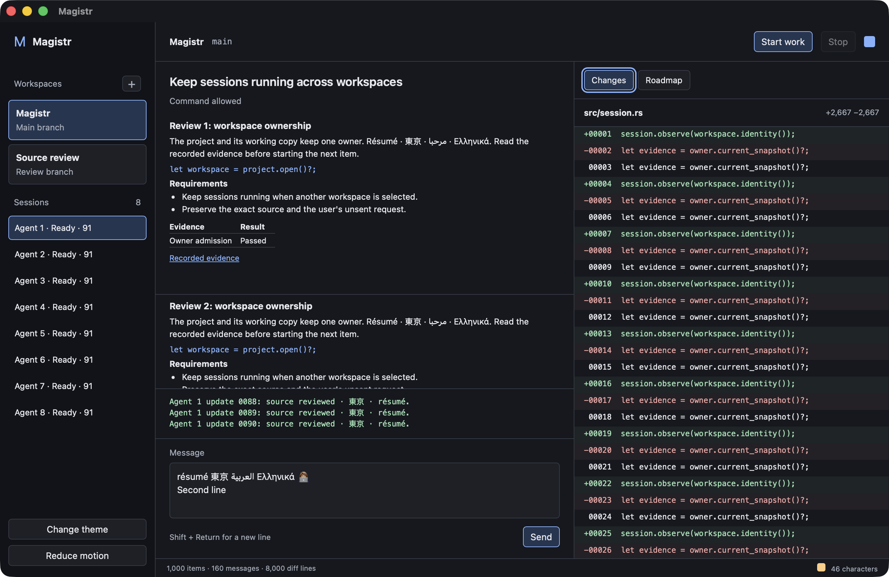
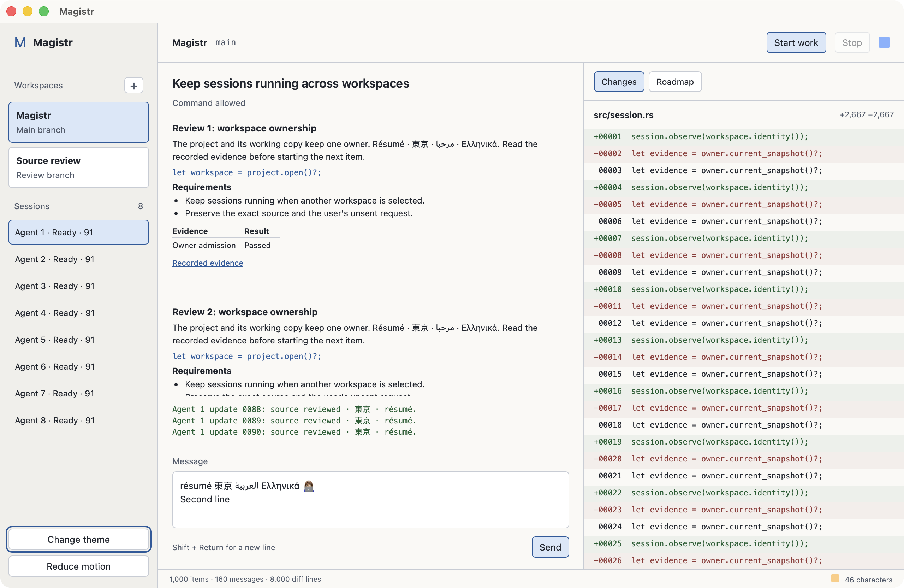

# Desktop foundation

Decision recorded **12 October 2026** for `rust-gui-foundation`, from code at
`cfd1132` and the retained [native evidence](../evidence/desktop-foundation/README.md).

**Select Tauri 2: one Rust host, one OS WebView, semantic HTML/CSS presentation.**
GPUI is materially cheaper in memory and idle CPU. The tested Tauri path provides
usable rich-document semantics, native editing and ordinary keyboard/VoiceOver
navigation with less custom widget work. This is a bounded foundation proof,
not production desktop acceptance. The current delivered desktop is described
in [desktop.md](desktop.md); the owner repairs and atomic replacement below
remain necessary.

## Candidates and reproducible versions

| Candidate | Source, compiler and license | Text, accessibility and integration | Platform and distribution |
| --- | --- | --- | --- |
| Tauri 2 | Exact `tauri 2.12.0`; build `2.7.2`, macros `2.7.2`, runtime/wry runtime `2.12.1`, wry `0.57.0`, tao `0.37.1`. MIT/Apache-2.0. Official versioned releases and tooling; the lockfile is authoritative. | Rust application host, OS WebView; semantic HTML supplies headings, lists, tables, links, selection and native text services. Typed IPC must call existing Rust application ports. Rust channel delivery needs a bounded presentation queue. This prototype uses plain JS/CSS, with no React or Node runtime. | WKWebView on macOS, WebView2 on Windows, WebKitGTK on Linux. Official bundling/signing tooling exists; this experiment uses an ad hoc signed macOS fixture bundle, not a distributable release. |
| GPUI | Upstream `c66312b200d113694fca08c1d468669028a09a0e` (12 October 2026); package `0.2.2`, platform `0.1.0`. Apache-2.0. Active Zed development, but this capability is pinned source, not a stable standalone release contract. | Native GPU renderer, custom text/widget integration. Current source has AccessKit and macOS/Windows/Linux bridges; the published `0.2.2` crate inspected here lacks that path. Native composition/selection needed explicit UTF-16/preedit handling. Rich-text roles, multiline editing and reader focus require further widget work in this prototype. | macOS, Windows and Linux backends exist in source. Packaging, assets and the independent application shell require integration beyond adopting a Zed library. Only macOS was built/exercised. |
| Iced | `0.14.0`, Rust minimum `1.88`, MIT. Versioned release with reactive rendering and IME work. | Its current FAQ documents text-direction/editor limitations, and accessibility issue 552 remains open. No demonstrated complete reader path meets this baseline, so it was excluded before timing. | Desktop platform/rendering backends exist; application bundling and native-reader acceptance would still need proof. No prototype or runtime performance claim is made. |

Primary sources: Tauri's [process model](https://v2.tauri.app/concept/process-model/),
[frontend channels](https://v2.tauri.app/develop/calling-frontend/),
[distribution guide](https://v2.tauri.app/distribute/) and
[macro release](https://tauri.app/release/tauri-macros/v2.7.0/);
GPUI's [upstream guide](https://github.com/zed-industries/zed/blob/c66312b200d113694fca08c1d468669028a09a0e/crates/gpui/README.md)
and [pinned source](https://github.com/zed-industries/zed/tree/c66312b200d113694fca08c1d468669028a09a0e/crates);
Iced's [release](https://github.com/iced-rs/iced/releases/tag/0.14.0),
[FAQ](https://book.iced.rs/faq.html) and
[accessibility issue](https://github.com/iced-rs/iced/issues/552).
The dependency source inspection distinguishes available APIs from working
application integration.

Both finalists built with the **installed Rust 1.99.0**, edition 2024, release
opt-level 3, thin LTO, one codegen unit and stripped debug information. The default
stable compiler is 1.95; it did not constrain selection. Other installed choices
include nightly, 1.82, 1.87, 1.88, 1.89, 1.90, 1.93.1, 1.96 and 1.97.1.
The [build record](../evidence/desktop-foundation/build.json) records exact
compiler details, all toolchains, dependency source/binary hashes and WebKit
`21624.2.5.11.8`. The selected fixture's later composer correction and removal of
GPUI have a separate [validation record](../evidence/desktop-foundation/selected-validation/build.json).

## Measured result

The [protocol](../../benchmarks/desktop-foundation/protocol.md) declared budgets
before timing: 2 seconds usable startup, 512 MiB app-plus-helper RSS, 1% of one
core idle CPU, 50 ms p95 input, 16.7 ms frame work at 60 Hz, and no lost/reordered
updates. All are targets, not automatic release acceptance.

Same Apple M5 Max (Mac17,6; 18 CPU/40 GPU cores, 48 GB), macOS 26.5.2
(build 25F84), 1,728 × 1,117 logical display at 2×. Both retain 1,000 roadmap items,
160 nine-line rich messages and 8,000 diff lines. Eight independent Rust producers
emit 1,250 updates each at 125 Hz. Long lists are virtualized; the complete
corpus and stream text remain retained, and the selected live view shows three
tail lines. No live provider or project store is involved.

Five alternating fresh-process launches and three alternating active runs per
candidate; filesystem caches are warm. Values below are p95 within each run,
then the range across runs, rather than pooled samples or benchmark maxima.

| Measure | Tauri | GPUI | Interpretation |
| --- | --- | --- | --- |
| Fresh launch p95 | 633 ms | 398 ms | Both below 2 seconds; includes observer/file-poll overhead |
| Idle CPU, % of one core | 2.20–2.40% | 0.85–0.86% | Tauri misses the 1% budget |
| Idle total RSS | 263.6–264.2 MiB | 145.6–145.9 MiB | Includes every app-coalition helper |
| Peak total RSS | 369.7–386.4 MiB | 195.5–196.2 MiB | Both below 512 MiB |
| Keystroke to visible pixels p95 | 19.3–20.4 ms | 20.1–24.4 ms | Both below 50 ms |
| Workspace switch to visible pixels p95 | 26.6–30.3 ms | 21.3–24.7 ms | Directly observed marker change |
| Changing-frame display interval p95, scroll | 17.9–18.7 ms | 17.8–18.1 ms | Both exceed 16.7 ms visible cadence |
| Changing-frame display interval p95, resize | 25.8–26.4 ms | 28.4–35.2 ms | Both exceed 16.7 ms visible cadence |
| Streaming CPU, % of one core | 52.0–54.5% | 37.9–40.5% | Historical endpoint estimates plus conservative late-helper bounds |
| Delivered/acknowledged throughput | 997.8–998.1 updates/s | 999.4–1,000.6 updates/s | Producer-limited workload, not maximum capacity |
| Per-event rendering acknowledgement p95 | 31.2–32.3 ms | 18.6–19.2 ms | Different callback boundaries; not visible-pixel latency |
| Loss, gaps, acknowledgement delay >50 ms | 0 / 0 / 0 | 0 / 0 / 0 | Every run receives and acknowledges all 10,000; eight final counters equal 1,250 |

[Raw comparison](../evidence/desktop-foundation/performance/comparison.json),
[all-process samples](../evidence/desktop-foundation/performance/tauri/run-0/results.json)
and [CPU bounds](../evidence/desktop-foundation/cpu-bounds.json) retain the evidence.
The CPU reducer's earlier streaming start snapshot was not saved; any omitted
late ThemeWidget helper cost is bounded by its whole lifetime counter. Idle PID
sets are stable. The selected observer now saves both endpoints, counts helper
births and rejects incomplete accounting when an initial PID exits.

GPUI's profiler reports full Draw p95 of 2.67–2.72 ms. Tauri's virtual-list
JavaScript handlers report p95 of 2 ms at WebKit's coarse 1 ms clock resolution;
that excludes browser layout, paint and GPU work. These are different scopes,
so neither number is a comparative full-frame claim. Full WebView pipeline CPU
frame time is unavailable here. ScreenCaptureKit display timestamps measure
observed changing pixels at 120 samples/s, on a display advertising up to 120 Hz;
resize input is 60 Hz. Adaptive display cadence/capture and CPU frame work are
separate. A controlled 60 Hz full-pipeline run remains a delivery requirement.

RSS sums resident sets and can count shared pages more than once. CPU uses
resource-coalition membership and mach ticks calibrated to getrusage; observer
CPU is outside that coalition. All WebContent, GPU, Networking, audio,
SafariPlatformSupport and ThemeWidget helpers observed for the candidate are
included. Background load averages were about 6–12 on 18 cores; the experiment
is not an otherwise idle or reboot-cold-cache certification. Windows/Linux
native input, readers, packaging and process settlement were unavailable.

## Editing and real screen-reader evidence

The [Tauri journey](../evidence/desktop-foundation/journeys/tauri/journeys.json)
passes 15 automated checks: multilingual multiline editing, exact copy and
partial selection, Shift+Return, named workspace chooser, unsent-draft retention,
keyboard switching/review, streaming/stop, request answer, roadmap evidence,
themes and reduced-motion preference. Native Japanese conversion is retained
as a separate observed result.
The [GPUI journey](../evidence/desktop-foundation/journeys/gpui/journeys.json)
records 16 checks including Japanese conversion and fails Shift+Return: its
custom editor omits the new line.
It successfully converts Japanese and retains/copies the multilingual draft;
these are actual native text services, not inserted test strings.

Tauri's composer originally sent converted text because WebKit emits
compositionend before the committing Return key-down with isComposing false.
A composer-owned lifecycle now handles both event orders. Six regression tests
and a fresh native window verify that Return commits 日本 without sending and
a separate Return sends the exact draft. The successful
[native conversion](../evidence/desktop-foundation/journeys/tauri/ime.json) and
[first-use observation](../evidence/desktop-foundation/diagnostics/first-use-ime.json)
remain retained. Later unattended attempts selected the reported Japanese
source but produced Latin text; the
[failed observation](../evidence/desktop-foundation/diagnostics/unavailable-ime-automation.json)
is retained too. Automatic input-method activation is therefore unavailable
in the final journey gate. The observer needs a separate owning diagnostic;
this proof does not claim reliable unattended IME coverage.

VoiceOver was actually running. Its caption panel was captured and read using
Apple Vision OCR, with the real reader PID, keys, accessible focus and caption
images retained. Protected AppleScript speech permission remained off.
The [Tauri walk](../evidence/desktop-foundation/voiceover/tauri/walk.json)
announces the ordinary Tab sequence, names sessions and controls, and activates
Start work using Control+Option+Space. Its tree exposes native headings, lists,
tables, links and editable text. The
[GPUI walk](../evidence/desktop-foundation/voiceover/gpui/walk.json)
stays on a generic group during ordinary Tab navigation. Explicit reader-group
interaction and [navigation](../evidence/desktop-foundation/voiceover/gpui/navigation.json)
can name and activate workspace/Start controls, but the captured tree has only
one static-text node despite the visible rich conversation.

These are adapter integration results, not a claim that GPUI has no accessibility
API. Tauri wins the demonstrated rich-text and reader path; GPUI wins the measured
memory/idle tradeoff. A production reader matrix, modal focus restoration,
high-contrast preferences, arbitrary long drafts and broader IMEs still require
delivery acceptance.

## Layout and five journeys

At the tested outer window of 1,280 × 832, the selected layout has a 224-pixel
project/session rail, a 57-pixel work header, a conversation/composer column and
an adjacent changes/evidence column taking 43% of the remaining width.
At 900 × 800 the rail contracts to 180 and the review column to a 245-pixel
minimum. [Actual narrow capture](../assets/desktop-foundation/tauri/narrow.png)
keeps the composer and review readable; long source lines remain horizontally
clipped in this bounded fixture and need deliberate review/scroll behavior in
the change-review item. GPUI's captured outer width is 1,281 because of its
native border; all observations retain actual geometry. No inherited GUI2
reference screenshot determines this layout.

Adopted reference patterns and purposes:

| Reference | Adopted pattern | Purpose in Magistr |
| --- | --- | --- |
| [Orca](https://www.onorca.dev/) / [source](https://github.com/stablyai/orca/blob/main/README.md) | Project/working-copy navigation, session attention, adjacent source review | Keep concurrent work visible and make a request or changed file one action away |
| [Jean](https://jean.build/docs) / [source](https://github.com/coollabsio/jean) | Project rail, named sessions, explicit themes and changes | Separate choosing what to view from controlling a turn; retain a familiar composer |
| [Superset](https://docs.superset.sh/superset-model) | Project → isolated working copy, session context, nearby file/diff review | Keep branch context visible while reviewing the agent's work |

The concrete journey contracts describe production intent. This fixture serves
its own finite corpus and producers; it does not claim live session admission,
real approvals or persisted workflow evidence.

| Journey | Trigger and visible result | Owning production behavior | Actual fixture evidence |
| --- | --- | --- | --- |
| Open a workspace | Open workspace → named chooser → select Magistr/Main or Source review/Review. Header and rail agree; the unsent message remains. | Application resolves project/working-copy identity and attaches/admit existing owners; selecting a view does not stop work. Failure remains in the chooser with an actionable error. | [Chooser](../assets/desktop-foundation/tauri/workspace-picker.png), draft/switch records in journey JSON |
| Start and stop work | Select a session → Start work changes status to Working; Stop becomes available. Stop reaches a settled result while other session controls remain available. | Existing session supervisor admits a turn, emits its status, routes cancellation and settles the provider. Frontend does not infer completion from quiet output. | Eight independent producers, live sequence counters and settled-stop check in journey JSON |
| Answer a request | Waiting for you names the request, with Allow once and Deny next to it. Answer clears the request and retains the draft. | Existing permission decision service validates the correlated request; a stale response cannot apply to a different turn. | [Conversation/changes](../assets/desktop-foundation/tauri/changes.png), answer/draft record |
| Review a diff | Changes or Cmd+D opens file context with exact source lines and explicit additions/removals. Conversation/composer remain adjacent. | Existing workspace/source service supplies paths and versioned bytes; proposed changes and apply/check receipts belong to that owner. | 8,000-line virtualized [diff capture](../assets/desktop-foundation/tauri/changes.png); source-review model remains future work |
| Inspect roadmap evidence | Roadmap or Cmd+R → select a named item → read requirements and recorded check/source evidence in the same column. | Native engine supplies typed snapshots/events; roadmap/ship/think mutations enter the admitted native writer. Current state is read back after a mutation. | 1,000-item [roadmap capture](../assets/desktop-foundation/tauri/roadmap.png), selected-item/evidence record |

Pointer and keyboard sequences were exercised in actual windows. Status uses
words as well as color. Foreground/focus contrast, the existing Magistr icon and
native dark/light/narrow captures are audited with the focused artifact gate.
The fixture has no animated motion; production motion must use model ticks and
respect reduced motion. Rich authored source text and drafts remain exact; the
renderer presents semantic documents rather than maintaining a second history.

## Owners and coherent cutover

| Behavior | Current owner and verified defect | Required target and native roadmap owner |
| --- | --- | --- |
| Project/working-copy selection | CLI `ProjectWindow`; switching admits a new host and settles the old one in [project_window.rs](../../crates/magistr-cli/src/application/project_window.rs) | Repair existing application workspace authority in `rust-gui-workspace-authority`; selection is presentation, admission is application behavior |
| Resident sessions and cancellation | CLI `SessionSupervisor` / admitted [interactive host](../../crates/magistr-cli/src/application/interactive_host.rs); window selection currently ends the prior host | Keep application-owned sessions alive independently of the selected view in `rust-gui-session-lifetime`; typed events and correlated controls reach the actual session |
| Saved session history | [History reader](../../crates/magistr-cli/src/orchestration/commands/galaxy_data.rs) queries saved sessions, but storage's insert_session has no production writer | Add authoritative session metadata/checkpoint writing at the session owner in `rust-gui-session-history`, then make the reader consume those records; no UI-only database or invented history |
| Workflow and source | `EngineClient`, admitted native engines and one `WorkspaceService` per canonical root | Reuse [project authority](project-authority.md), [workspace owner](workspace-owner.md), typed [projections](projections.md) and verified source transactions |
| Retained reading, selection and drafts | Shared `TextDocument`/`RequestHistory` and per-session presentation state | Reuse semantic rich-document ownership; DOM owns native text interaction, application owns durable session/draft records. No localStorage workflow/history authority |
| Product launch and process lifetime | [magistr-desktop launch](../../crates/magistr-desktop/src/launch.rs), terminal-free host composition and `magistr-process` | Replace the renderer through this composition after the owner prerequisites; `rust-gui-delete-old-interfaces` removes GUI2/TUI entry paths and updates every current caller together |

The target composition is Rust application/host → existing session/workflow/source
ports → bounded typed snapshots/events → one Tauri presentation adapter.
The WebView cannot open SQLite, spawn a competing workflow/workspace server or
decide policy. IPC carries typed requests/results, with bounded payloads and
owned cancellation. Rust owns durable data and subprocess settlement; the
renderer owns native window text/focus/layout and presentation caches.
The cockpit stays independent of terminal protocols and the desktop independent
of `magistr-tui`. Any needed extraction belongs at the existing owner and updates
all current callers in one finished change.

The ordered owner items already cover the verified selection/lifetime/history
defects. The replacement item changes the production launcher and removes
retired surfaces together; it does not keep aliases, a renderer selector or
compatibility paths. Later supervision/change-review/planning/setup/settings
items connect the five journeys to real authorities. The delivery item enforces
the unchanged budgets, controlled 60 Hz measurement, Linux/native-reader lanes,
installation and process cleanup before supported-platform release claims.

The active proof workspace contains only Tauri and the shared workload.
The losing GPUI implementation is an immutable evidence archive, outside the
active dependency graph. Existing production renderer sources and the legacy
GUI ratchet were preserved for their explicitly owned deletion item.
