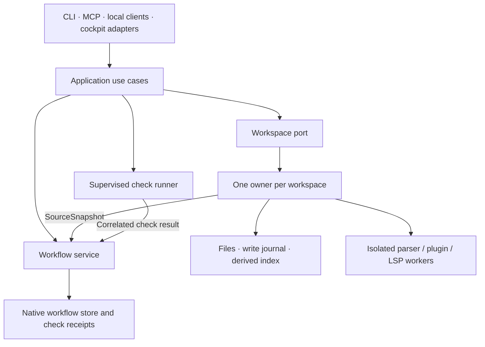

# First-party workflow and workspace subsystems

Decision: accepted on 10 September 2026, authorized by the project owner.
Native reasoning `think:712` supersedes the adapter-based receipt plan in
`think:710`. Workflow source and typed use cases are now repository-local;
workspace integration remains pending. This document distinguishes the
adopted source from the target behavior and migration constraints. The native
roadmap remains authoritative for delivery status.

## Source baselines

Both repositories were inspected locally with clean working trees. Imports must
recheck the source and record any change from these audited revisions.

| Subsystem | Audited checkout | Revision | License |
| --- | --- | --- | --- |
| think-and-ship | `/Users/alrik/Code/think-and-ship` | `8c10c1fcfb479e90b33c59502eabd92586cf0761` (0.6.0) | MIT |
| Workbench | `/Users/alrik/Serious_Code/workbench-mcp` | `2a2430bbcd5dcbed00920f92c6f3e6928f387d95` | Apache-2.0 |

These paths identify research inputs, not runtime or build dependencies.
Magistr owns the workflow fork at
[`subsystems/workflow`](../../subsystems/workflow/PROVENANCE.md), imported after
rechecking the clean think-and-ship checkout at the audited revision. The Rust
service, bundled skills, tests, and their supporting documentation and fixtures
retain their inherited layout. The root Cargo workspace and lockfile resolve
the adopted crate for both Magistr consumers through relative path dependencies.
The [provenance record](../../subsystems/workflow/PROVENANCE.md) identifies the
license, included and excluded components, and verification boundary. Workbench
source adoption remains pending. Magistr owns these forks' tests, compatibility,
and release cadence; future upstream changes are reviewed imports.

## Why change ownership now?

Magistr must decide whether evidence permits completion. In the audited
think-and-ship source, `ship/engine/mod.rs::ship` completes an objective while
returning warnings for incomplete tasks or failed required checks. Some
cross-family validation and execution sequencing live in async MCP handlers.
Before extraction, Magistr reached those handlers through a synchronous
adapter. That bridge has been deleted: NativeEngines and MCP now call the same
family application use cases. Stronger receipt policy belongs to that native
workflow boundary, rather than a second semantic owner in a transport.

The earlier integration preserved dependency behavior while consolidating
callers. That remains useful history, but treating the dependency as fixed is
now the wrong constraint. Put the required behavior into an owned workflow
service and make every supported transport use it.

Workbench ownership is equally substantive. At the audited revision,
`crates/workbench-core` supplies parsing, search, rewriting, index extraction,
and plugin sandboxing. Bun/TypeScript supplies the write engine, journal,
path admission, protected-file policy, index orchestration, and transport.
Importing only the Rust crate would omit much of the workspace authority.

## Target boundaries

Workflow owns objectives, tasks, reasoning, roadmap, cross-family mutations,
receipt admission/settlement, and completion policy. Typed commands and queries
sit below MCP, CLI, and local protocols. Internal calls do not serialize to
tool JSON or poll async handlers with a noop waker. Transport dispatch still
owns protocol concerns; shared diagnostics must survive the extraction.

Workspace owns path admission, navigation, edits, confirmation, session-scoped
undo, write recovery, indexing, and source snapshots. The index remains a
derived cache. Workflow project identity and workspace/worktree identity are
distinct; multiple worktrees must not accidentally share file ownership.

The application composes these services through narrow ports. This does not
require one global mutex, one database, or a single process containing every
worker. Checks run outside mutation locks; their results return to the
admitted workflow owner with immutable correlation and provenance.

## Workbench migration constraints

Workbench's `specs/018-multi-client-daemon/adr.md` adopts one workspace owner
with thin stdio clients, but that implementation has not landed at the audited
revision. Its opt-in `test/multi-client.test.ts` cases are deliberate red
reproductions. Adapt that design to Magistr's local owner/client composition;
do not introduce a competing workspace daemon beside an existing owner.

The owner must preserve client/session identity, bind confirmations and undo
to that identity, fence stale generations, and define disconnect, reconnect,
shutdown, and crash behavior. Replace age-based lock stealing with OS-held
admission and generation fencing: the audited lock can declare an old lock
stale even while its recorded process is alive. Never kill a current owner
to acquire its workspace.

Source adoption preserves the Bun/NAPI boundary initially. A Rust rewrite is
a separate, measured decision requiring behavior parity. The audited build
requires an explicit platform/feature matrix: Rust 1.95, Bun 1.4.1, NAPI and
addon fallback, parser packs, and Wasmtime dependencies. The core's
`no-bindings` test path is not proof of a shipping native service.

Retain canonical path and protected-file checks, binary journal semantics,
confirmation guarantees, parser-worker isolation and backpressure, plugin
capability/resource limits, and optional LSP isolation. Preserve the
[Wasmtime security model](https://docs.wasmtime.dev/security.html) when
changing composition. Ownership consolidation is not a reason to inline
untrusted or crash-prone execution.

## Evidence requires source identity

The workspace service publishes a versioned `SourceSnapshot` capability,
including workspace identity, selection-policy digest, content-manifest
digest, and declared consistency guarantees. Its policy must account for
external edits, relevant ignored/untracked files, configuration, binary data,
symlinks, and modes. An index generation or a journal sequence is not a
source revision: the audited write engine allocates journal sequence before
file swaps, and a watcher can be disabled or lag behind external writes.

Applied-write outcomes must distinguish intent, successful application,
rollback, and crash uncertainty. Verification consumes this workspace
capability instead of adding another file scanner to workflow.

Two matching before/after digests alone do not prove that a check executed
against immutable inputs. The contract must distinguish optimistic
observation from an isolated immutable snapshot and reject unsupported
certification claims. Completion also validates objective/task/run/attempt
identity, gate and acceptance revisions, required outcomes, and source
freshness. Late results remain durable without attaching to a newer objective.

## Delivery and preserved work

| Chunk | Implementation boundary |
| --- | --- |
| `arch-14a-workflow-source-fork` | Repository-local workflow source adopted; native state and behavior preserved |
| `arch-14b-workflow-use-cases` | Typed family use cases, ordinary completion policy, and run/task admission beneath transports; receipt enforcement remains deferred |
| `arch-14c-workbench-source-fork` | Pending: Bun/TypeScript service and Rust core adoption |
| `arch-14d-workspace-owner` | Pending: admitted owner serving multiple clients |
| `arch-14e-source-snapshots` | Pending: `SourceSnapshot` producer and consistency contract |

The native refactor continues with workspace source adoption, owner/client
integration, and source certification.
Receipt completion depends on both the typed workflow service and source
snapshots. Configuration, supervision, projections, host cleanup, diagnostics,
module gates, and final acceptance inherit the applicable dependencies.
The former request for an upstream synchronous handler API is absorbed by
the owned workflow extraction.

Workflow adoption preserves behavior and persistence before changing semantics.
Continue to use repository-local dependencies and reproducible lockfiles; a
temporary
[Cargo override](https://doc.rust-lang.org/cargo/reference/overriding-dependencies.html)
must have a removal point. Do not retain duplicate release-coupled versions
or migrate a live owner's store. Imported source participates in the real
quality gates rather than receiving a blanket vendor exemption. The workflow
crate participates in root workspace formatting, check, Clippy, and nextest;
the structure gate tracks inherited style with a per-file baseline that may
only decrease.

The unfinished receipt implementation is preserved as a blocked checkpoint,
including regressions and runner work. Its temporary MCP interceptions and
duplicate policy must be replaced during migration. It has not passed the
integrated or full required gates and is not committed or finalized.
Its objective/task recovery remains native `think:714`. On the owner's request
to continue on `main`, the exact draft (16 tracked changes and nine untracked
source files) moved to the verified recovery bundle
`/Users/alrik/Backups/magistr-main-integration-20260910T190025Z/receipt-draft`.
The bundle includes file bytes, modes, a manifest, and the original tracked
patch (`aef0050960e1faf9e96442abbfe51380ce86b69ade95907393cbebfc68f4e2cb`).
Main contains the reviewed native extraction; the paused receipt draft was
neither committed nor silently adopted. Neither source repository was modified.

All implementation chunks require formatting, recorded configured gates,
applicable imported suites, architecture and interface regressions, and
truthful completion evidence. Native roadmap exports remain disabled.
