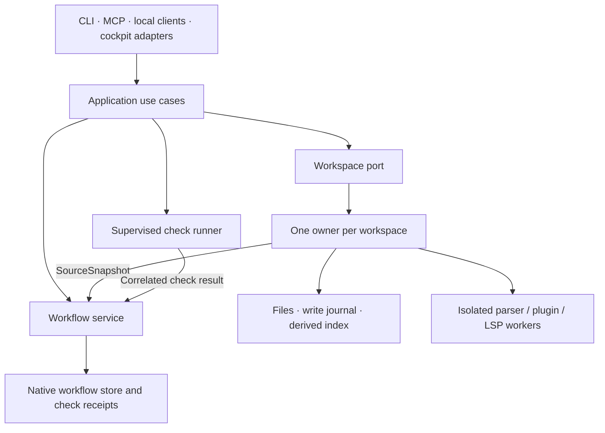

# First-party workflow and workspace subsystems

Decision: accepted on 10 September 2026, authorized by the project owner.
Native reasoning `think:712` supersedes the adapter-based receipt plan in
`think:710`. Workflow source and typed use cases, the Workbench reference source,
and its native Rust engine are now repository-local.
The accepted target is one Rust-native Magistr product. Native workspace
service composition, Unix client attachment and the production launcher are
implemented; every workspace client reaches one admitted native owner. This document distinguishes the
adopted source from the target behavior and migration constraints. The native
roadmap remains authoritative for delivery status.

The [pre-release policy](../../AGENTS.md#before-public-release) supersedes every backward-compatibility
constraint in this decision, its linked plans, and imported reference material.
There is no obligation to retain old tool names, separate MCP endpoints, aliases,
configuration, protocols, schemas or stored formats. Reference comparisons are
historical evidence; change current contracts and their tests together when the
intended design changes.

## Source baselines

Both repositories were inspected locally with clean working trees. Imports must
recheck the source and record any change from these audited revisions.

| Subsystem | Audited checkout | Revision | License |
| --- | --- | --- | --- |
| think-and-ship | `/Users/alrik/Code/think-and-ship` | `8c10c1fcfb479e90b33c59502eabd92586cf0761` (0.6.0) | MIT |
| Workbench | `/Users/alrik/Serious_Code/workbench-mcp` | `2a2430bbcd5dcbed00920f92c6f3e6928f387d95` | Apache-2.0 |

These paths identify research inputs, not runtime or build dependencies.
Magistr owns the workflow fork as
[`magistr-workflow`](../../crates/magistr-workflow/Cargo.toml) (library
`magistr_workflow`), imported after rechecking the clean think-and-ship
checkout at the audited revision and rehomed under Magistr's name by
`arch-14f4-rehome-naming`; the imported contract, fixtures, docs and the
[provenance record](../../subsystems/workflow/PROVENANCE.md) stay under
`subsystems/workflow`. The Rust service, bundled skills and tests keep their
inherited layout inside the crate; the standalone binary, CLI, skill embedding
and upstream packaging are deleted. The root Cargo workspace and lockfile
resolve the crate for both Magistr consumers through relative path
dependencies at the one first-party version. The provenance record identifies
the license, included, excluded and retired components, and the verification
boundary.
Workbench's audited source is retained under
[`subsystems/workspace/reference`](../../subsystems/workspace/PROVENANCE.md),
with every original Git file accounted for in the upstream manifest and local
repairs recorded separately. Its Rust engine is adopted into
[`magistr-workspace`](../../crates/magistr-workspace/src/lib.rs), a first-party
root workspace member. The
[feature inventory](../../subsystems/workspace/FEATURE_INVENTORY.md) maps all
tools, contracts, storage and degraded paths to native implementation chunks.
The upstream package declares Apache-2.0 but omits a root license file;
[third-party notices](../../subsystems/workspace/THIRD_PARTY_NOTICES.md) record
that limitation and retained guest/grammar attribution. Magistr owns these
forks' design, tests and release cadence; future upstream changes are
reviewed imports.

## Why change ownership now?

Magistr must decide whether evidence permits completion. In the audited
think-and-ship source, `ship/engine/mod.rs::ship` completes an objective while
returning warnings for incomplete tasks or failed required checks. Some
cross-family validation and execution sequencing live in async MCP handlers.
Before extraction, Magistr reached those handlers through a synchronous
adapter. That bridge has been deleted: NativeEngines and MCP now call the same
family application use cases. Stronger receipt policy belongs to that native
workflow boundary, rather than a second semantic owner in a transport.

The earlier integration preserved dependency behavior while consolidating
callers. That remains useful history, but treating the dependency as fixed is
now the wrong constraint. Put the required behavior into an owned workflow
service and make every supported transport use it.

Workbench ownership is equally substantive. At the audited revision,
`crates/workbench-core` supplies parsing, search, rewriting, index extraction,
and plugin sandboxing. Bun/TypeScript supplies the write engine, journal,
path admission, protected-file policy, index orchestration, and transport.
Importing only the Rust crate would omit much of the workspace authority.

## Target boundaries

Workflow owns objectives, tasks, reasoning, roadmap, cross-family mutations,
receipt admission/settlement, and completion policy. Typed commands and queries
sit below MCP, CLI, and local protocols. Internal calls do not serialize to
tool JSON or poll async handlers with a noop waker. Transport dispatch still
owns protocol concerns; shared diagnostics must survive the extraction.

Workspace owns path admission, navigation, edits, confirmation, session-scoped
undo, write recovery, indexing, and source snapshots. The index remains a
derived cache. Workflow project identity and workspace/worktree identity are
distinct; multiple worktrees must not accidentally share file ownership.
The production workspace boundary will be an ordinary typed Rust service
composed into Magistr. The retained Bun/NAPI source is a reference for parity;
it is not a second product or a production Rust dependency. The CLI's
workspace launch, scaffold, interview and cockpit paths use the native owner;
the retained legacy server is reference-only.

The application composes these services through narrow ports. This does not
require one global mutex, one database, or a single process containing every
worker. Checks run outside mutation locks; their results return to the
admitted workflow owner with immutable correlation and provenance.

## Workbench migration constraints

Workbench's `specs/018-multi-client-daemon/adr.md` adopts one workspace owner
with thin stdio clients, but that implementation has not landed at the audited
revision. Its opt-in `test/multi-client.test.ts` cases are deliberate red
reproductions. Adapt that design to Magistr's local owner/client composition;
do not introduce a competing workspace daemon beside an existing owner.

The owner must preserve client/session identity, bind confirmations and undo
to that identity, fence stale generations, and define disconnect, reconnect,
shutdown, and crash behavior. Replace age-based lock stealing with OS-held
admission and generation fencing: the audited lock can declare an old lock
stale even while its recorded process is alive. Never kill a current owner
to acquire its workspace.

The accepted migration now targets Rust-native use cases and service ownership.
Source adoption extracts the existing Rust engine as an ordinary `rlib` without
NAPI, an addon loader, a build script, or a `no-bindings` feature. TypeScript
orchestration remains reference source until its behavior moves into the native
chunks; importing the engine does not complete tool parity or ownership.
The reference build retains its explicit platform/feature matrix: Rust 1.95,
Bun 1.4.1, NAPI/addon fallback, parser packs, and Wasmtime dependencies. The WASM
fallback disables native-only default features. The native library retains
Tree-sitter's Wasmtime 36 and the extension host's Wasmtime 48; their duplicate
compile cost is deliberate pending a measured compatible dependency change.
The reference core's `no-bindings` test path is not proof of a shipping native
service. Recorded checks must identify the actual feature and platform lane.

Retain canonical path and protected-file checks, binary journal semantics,
confirmation guarantees, parser-worker isolation and backpressure, plugin
capability/resource limits, and optional LSP isolation. Preserve the
[Wasmtime security model](https://docs.wasmtime.dev/security.html) when
changing composition. Ownership consolidation is not a reason to inline
untrusted or crash-prone execution.

## Native worker boundary

`magistr-workspace::worker::WorkerSupervisor` accepts typed requests and owns
a private `magistr --workspace-worker` child. The executable selects that role
before normal CLI configuration, terminal hooks, MCP startup or workspace
admission. Production workspace consumers still await native port parity and
owner integration. No Bun process, addon loader or second daemon is involved
in this native path.

Admission bounds queued and active calls together. A spawned worker is
admitted only after its readiness frame and the composition's restore step
(`WorkerRestore`: the admitted language packs replayed into that
incarnation) have both succeeded; an earlier incarnation's readiness never
certifies its replacement. One request executes at a
time in each worker, so a crash is attributed to the dispatched input only.
Versioned length-prefixed frames cap each payload at 32 MiB on both write and
read; startup requires the native parser/search/rewrite self-test. Absolute
deadlines cover queuing, restart backoff, readiness and request I/O. A cancelled
or dropped call kills and reaps a worker already executing synchronous code;
queued cancellation does not disturb another call. Unexpected child failure
adds a strike to a bounded input-fingerprint ledger. Changed input can retry,
and unrelated lexical reads remain available through the native search engine.

Shutdown stops admission, settles admitted requests, asks an idle worker to
close its sandbox pool, and reaps owned processes. Unix workers receive a
dedicated process group so abrupt failure also terminates LSP descendants;
no workspace lock PID is read or killed. LSP host sessions retain curated
specification/capability admission and OS parent-death guards. Their frame
readers now have bounded headers/queues and joined teardown; a shared pool
ceiling also counts private invocation sessions. Wasmtime fuel, memory and
default-deny capabilities remain in the existing sandbox implementation.

Dynamic grammar registrations and warmed LSP sessions are worker-local and
are lost on restart. Later index/extension owners must restore their admitted
configuration after observing a new worker generation. The worker API does
not claim index persistence, plugin manifest trust policy or complete public
tool parity.

## Native served surface

`magistr_workspace::service::WorkspaceService` is the composition root: one
admitted workspace per process, composed once — the resolved policy, the
private key, the sole journal writer with SQLite's applied mode read back,
the supervised worker, the derived index, the extension lanes, the
owned-process executor and the flight recorder — behind typed methods that
append the workspace's deterministic notes to every answer. Admission is an
OS-held exclusive lock on an atomically published, immutable native marker in
`.workbench/server.lock`. The retained legacy server refuses its foreign-host
JSON marker; native admission refuses legacy, empty or malformed records
untouched. No pid is ownership evidence, no age is judged, nothing is stolen
and no holder is signalled. A crash releases the OS lock, and each successful
admission durably advances `.workbench/server.generation` before stores open.
Missing, corrupt or exhausted generation state fails closed. Existing legacy
or c10 empty locks require [offline migration](../../subsystems/workspace/PROVENANCE.md#offline-migration).
The [workspace owner](workspace-owner.md) layers Unix multi-client attachment
on this admission through Magistr's shared local owner protocol. A second
`magistr workspace serve` connects to the admitted service without opening
another journal, index or worker; when that owner goes away the bridge answers
in-flight calls with the typed refusal and, on its next request, attaches to
the new owner or admits the workspace itself. Legacy migration refusals never
attach; `magistr workspace migrate` is the explicit, refusing migration.

`magistr workspace serve <root>` is the thin rmcp adapter over that service:
the complete retained tool surface with the eight input schemas and the
envelope output schema byte-identical to the reference tree, the sealed
envelope as both text and `structuredContent`, per-request envelope
negotiation and session identity from `_meta`, MRTR form elicitation with
the token fallback honoring `edit.confirm_mode`, the request's cancellation
token into search and run, the `index/build` task over SEP-2663 `tasks/get`
and the retained `tasks/list`, one trace span per call and namespaced plugin
tools after the core names. The initial stdio client and each attached Unix
connection receive independent MCP handlers over the same service. Each
connection receives a nonempty random default session; valid explicit metadata
preserves durable identity across connections.
Native mutation and session-journal APIs require a `WorkspaceSession` admitted
for the canonical root and current generation. Re-admitting the same identity
preserves undo history. `mgw2` confirmations bind that generation and reject
previous-owner previews, including all `wb1` and `mgw1` tokens. This local
identity boundary is not peer authentication. Production consumers reach the
workspace through the native bridge (`magistr mcp-launch workbench-mcp`);
`magistr mcp-serve` is unchanged.

Beside the MCP host, `magistr workspace doctor [bundle|config]`, `journal`,
`key rotate` and `init` are the CLI host over the same native diagnostics:
read-only and lock-free where the reference was, the retained renderings on
stdout, and the retained process exit codes (0 healthy, 1 findings, 64 usage,
65 durable data this binary cannot read, 66 missing root, 75 a live owner).

## Evidence requires source identity

The workspace service publishes the versioned `SourceSnapshot` capability
(`magistr_workspace::snapshot`, chunk `arch-14e-source-snapshots`). A
snapshot names the workspace (canonical root — two worktrees are two
workspaces — and the durable owner generation that was current), the
hashing scheme (`magistr-source-snapshot/1`), the selection policy and its
digest, and a content manifest: every selected path with its kind (text,
binary, symlink, missing explicit input), permission bits, byte length and
SHA-256. Selection is the workspace's own ignore-driven walk — hidden files
in, ignore rules honored with or without a repository, `.git` and
`.workbench` never entered, links recorded by target — plus explicit inputs
hashed even when ignored: gate configuration (`.magistr/project.json`,
`workbench.toml`) by default and caller-declared artifacts. The revision is
content-addressed over scheme, identity, policy and manifest; no mtime,
inode, watcher event, index generation or journal sequence participates. A
selection past the policy ceiling and a file that changes while it is being
hashed are refused, never truncated or guessed.

Capture (`WorkspaceService::source_snapshot`, or `SourceSnapshot::capture`
and `magistr workspace snapshot` lock-free beside a live owner) takes no
journal or mutation lock, so a consumer captures, runs its subprocess with
edits still flowing through the owner, and validates afterwards.
Validation re-runs the embedded policy on the same canonical root and
answers `Unchanged` or the exact `Added`/`Removed`/`Modified` paths; a
snapshot of another root is refused as a foreign workspace rather than
compared. `Unchanged` is itself an observation: an
`Consistency::Optimistic` snapshot can never certify immutable inputs, even
after matching digests before and after a run, because two agreeing reads
of a shared tree say nothing about the moments between them. The one path
to `Consistency::Immutable` is a `SourceExport` — the selected bytes copied
into a private directory this process owns, re-observed and required
identical — inside which a consumer executes.

Applied-write outcomes are read from the journal's resolved native intent,
never from its sequence: a `MutationReceipt` is `Applied` with a revision
over the applied files' after-hashes only when every swap succeeded and
read back, `Failed` when the intent was rolled back, and `Indeterminate`
for a pending intent after an interruption, a failed compensation or
outcome persistence, and for legacy history that predates native intents.
Verification consumes these workspace capabilities instead of a second
scanner or fingerprint in workflow: `arch-14-verification-receipts`
composes `WorkspaceEvidence` (the snapshot under the default policy, the
external configuration layers' `ConfigDigest` since
`audit-260912-17-config-evidence`, plus the gate resolver) as the
workflow's one `EvidencePort`, every
server-executed check — `magistr_gate`, the loop's gates, native
`ship_check` — carries a durable `CheckReceipt` bound to the observed
revision, and completion validates run/task-instance/attempt identity,
gate contracts, acceptance revision, required outcomes and source
freshness against the current tree
([project authority](project-authority.md#receipts-and-the-evidence-capability)).
The interrupted adapter-side draft (an engine-owned fingerprint scanner,
receipt store and ad-hoc gate reader) never reached main and was not
imported; its useful shapes — per-attempt records, context rejection,
recovered versus outstanding — informed the workflow-owned design.

## Delivery and preserved work

| Chunk | Implementation boundary |
| --- | --- |
| `arch-14a-workflow-source-fork` | Repository-local workflow source adopted; native state and behavior preserved |
| `arch-14b-workflow-use-cases` | Typed family use cases, ordinary completion policy, and run/task admission beneath transports; receipt enforcement remains deferred |
| `arch-14c-workbench-source-fork` | Reference source retained with complete provenance; native Rust engine adopted and checked as a first-party library; service cutover deferred |
| `arch-14c1-workspace-policy` | Native configuration and immutable path/command admission, private key lifecycle, typed response/byte contracts and reference fixtures; no production cutover |
| `arch-14c2-workspace-workers` | Native supervised parser, grammar and sandbox/LSP workers with bounded admission and owned cleanup |
| `arch-14c3-workspace-index` | Native SQLite/FTS cache, background worker extraction, bounded watcher refresh and live candidate revalidation |
| `arch-14c4-workspace-queries` | Typed admitted read/search/map queries, native worker/index composition, retained ranking/Cargo goldens and independent-root envelope comparison; transport and plugin inventory integration deferred |
| `arch-14c5-workspace-journal` | Native v1/v2 durable SQLite journal, exact-byte CAS history, read-only views and undo restoration plans; no filesystem application |
| `arch-14c6-workspace-transactions`–`arch-14c7-workspace-editing` | Pending: verified transactions, edit/files and applied undo |
| `arch-14c8-workspace-extensions` | Plugin manifests, grants, breaker, host and TCK, the QuickJS script verb and the lang-pack/ranking/resolver/runner lanes over the worker |
| `arch-14c9-workspace-execution` | Owned-group declared-command execution with the retained parsers, plus read-only status/journal/trace/doctor diagnostics |
| `arch-14c10-workspace-port-parity` | Typed `WorkspaceService` composition root with OS-held single-owner admission and the thin rmcp adapter `magistr workspace serve`; served conformance in disposable workspaces and against the reference server |
| `arch-14c10b-workspace-port-acceptance` | The operational verbs (`magistr workspace doctor [bundle|config]`, `journal`, `key rotate`, `init`) with the retained renderings and exit codes; the Bun-free release smoke as the required `workspace-release-smoke` gate; the supported matrix (`subsystems/workspace/SUPPORT_MATRIX.md`); the measured budgets (`subsystems/workspace/bench/`), all four holding after the references lane was brought back to the retained index-driven candidate design |
| `arch-14d1-workspace-fencing` | Immutable legacy-compatible admission, durable owner generations, explicit sessions and generation-bound confirmations |
| `arch-14d2-workspace-attachment` | Unix clients attach to one admitted `WorkspaceService` through the shared owner protocol; native process tests and the [ADR-018 scope matrix](workspace-owner.md#adr-018-scope) distinguish delivered attachment from remaining lifecycle work |
| `arch-14d-workspace-owner` | The session-stamping bridge with on-demand reconnect and typed unavailable answers, build refusal, worker exit on owner death, the native `workbench-mcp` launch alias with the external resolver deleted, cockpit and Codex clients through one owner, and the guarded legacy migration verb; the [ADR-018 matrix](workspace-owner.md#adr-018-scope) maps every row to executed evidence |
| `arch-14e-source-snapshots` | The `snapshot` module: `SourceSnapshot` (identity, generation, scheme/policy digests, content manifest, optimistic validation with foreign-workspace refusal), `SourceExport` for immutable inputs, `MutationReceipt` from the resolved durable intent, the owner's `source_snapshot`/`validate_snapshot`/`mutation_receipt` and the lock-free `magistr workspace snapshot` verb; check consumption remains `arch-14-verification-receipts` |
| `arch-14f-native-application` | The [composition boundary](application.md#the-composition-boundary) `magistr::application`: `AdmittedCheck`/`SettledCheck`/`CheckIdentities` binding a workflow check admission to a lock-free source observation and settling both; `magistr_gate` and the loop driver routed through it; the contract-only workflow/checks/projections facades deleted; `arch-11b` retired on evidence; the [standalone surface decisions](#standalone-surface-decisions) below; source-write routing (`arch-14f2`), the client audit (`arch-14f3`) and rehoming (`arch-14f4`) split out |
| `arch-14-verification-receipts` | Durable `CheckReceipt`s in the workflow's ship family (`ReceiptLedger`, one published file per receipt, outliving the cycle), the `EvidencePort`/`SourceWitness`/`GateContract`/`CheckExecution` types, receipt-bearing admission and settlement with stale results kept under their own identity, `verify_completion` and the roadmap's completion authority on every route (`roadmap_set_status(done)` refused), `ShipReport` recovered versus outstanding; Magistr's `WorkspaceEvidence` + `writer_config` composed at every production admission, the cockpit failing closed without it, `native-write-path` rule 8; the gate resolver moved to `magistr_core::gates` |
| `arch-14f2-source-pipeline-routing` | The workspace `write` verb (exact bytes, anchored, verified, journaled, never confirm-gated) behind `WorkspaceService::write`; the `SourceWriter` capability in `magistr-application` and `LocalEffectPort` routing an authorized `fs/write_text_file` through it with route-stamped events; `HostedWorkspace` + `WorkspaceSourceWriter` in [`magistr::application`](application.md#the-hosted-workspace) so `magistr run` and the cockpit loops own the workspace and their bridges attach; the `magistr-process` crate as the [one process mechanism](application.md#one-process-mechanism) under the gate runner, the workflow's `ship_check` runner and the workspace's declared-command executor, the pty pair rehomed there from `magistr-acp` |
| `arch-14f4-rehome-naming` | The fork rehomed as `crates/magistr-workflow` (`magistr-workflow` 0.1.0, `magistr_workflow`) with provenance under `subsystems/workflow`; `magistr_engine::tas` → `native` (`NativeConfig`); the standalone binary, CLI, skill embedding, examples, packaging files and their tests deleted, the served tracker plumbing rehomed to `tracker::host`; the workflow-source gate pins the deletions and one first-party version, the structure baseline follows the crate, native-write-path and lint-structure pin the new paths |
| `arch-14f3-client-audit-consistency` | The [client inventory](clients.md): every supported surface's workflow and workspace capability, admission path and test evidence; `native-write-path` rules 9–11 pinning where a `WorkspaceService` is opened, a writer admitted and an owner attached; the owner-command vocabulary left as is on the evidence that the attached cockpit is its only producer; the [consistency model](clients.md#workflow-consistency-model) stating read-through ship verbs against cached roadmap/signal/ship queries, backed by `tests/workflow_consistency.rs` |
| `audit-260912-15-admin-plan` | The [administrative change plan](configuration.md#administrative-change-plan): one `ChangePlan` of `PlannedChange`s (expected hash or absence, ownership judged from policy and manifest, apply/skip/refuse intent with reasons) computed by setup, selective apply, presets/import, template plugins, startup repair and owned Codex removal and executed by the same writers; `CanonicalSource` rendering a Magistr source checkout's live workflow templates and refusing missing or unreadable canonical input; reset left separate; application-time revalidation and receipts deferred to `audit-260912-16-admin-apply` |
| `audit-260912-16-admin-apply` | [Application and receipts](configuration.md#application-and-receipts): `scaffold::AdminService` as the one executor of setup/generation, selective apply, startup repair and owned Codex removal, revalidating each target's expected state at its write (`create_new` creates, temp-file-plus-rename overwrites, re-read removals) and answering an `ApplyReceipt` of per-change outcomes (applied / skipped / refused / failed with cause) plus the manifest outcome; partial receipts surfaced as errors naming what was applied; `native-write-path` rule 13 pinning administrative writes to the service; reset still separate |
| `audit-260912-17-config-evidence` | [Configuration evidence](configuration.md#configuration-evidence): `magistr_workspace::config::ConfigDigest` over the external layers (org-policy, user; content only, absent distinct from empty, unreadable refused) taken by `WorkspaceEvidence` from the captured project inputs; `SourceObservation` carrying `source_digest` and `config_digest` beside the revision, selection policy and owner generation; typed `ObservationDrift` naming the first identity that moved (workspace, scheme, policy, source, configuration, unbound) and `SourceFreshness::Reconfigured`; completion and cross-process settlement judging digests, never the owner generation; the MCP service refusing a config without evidence; the loop resolving contracts through the admitted port |
| `audit-260912-18-receipt-retention` | [Receipt retention](project-authority.md#receipt-retention): per-run membership index and exact-ID payload reads, explicit shared/native/MCP compaction, persisted current-run protection and retention of every unfinished receipt and unresolved loop-operation reference; legacy index migration and crash-window fixtures |
| `audit-260912-37-integration-promises` | Honest integration APIs: `tracker_setup` no longer accepts a push interval or reports auto-push fields (a supplied `push_secs` is refused by name before any write; the description says nothing is sent and no background push exists); the uncomposed realtime subscriber, doorbell, sweep and push schedules and push receipt store retired from `magistr-workflow` with the `tokio-tungstenite` dependency; every accepted setup setting proven at the application boundary (band, initiative, create_missing, dry_run); automatic cadences [documented as deferred](#standalone-surface-decisions) |

## Standalone surface decisions

The adopted trees carried surfaces that were products in their own right.
`arch-14f` decided each; `arch-14f4-rehome-naming` performed the deletions.

| Surface | Decision | Why |
| --- | --- | --- |
| think-and-ship `[[bin]]` (`src/main.rs`, `src/cli/*`: serve, init, skills, roadmap, tracker, otel, cloud, telemetry commands) | Deleted by `arch-14f4` | No Magistr code invoked it and it was not released; the seam tests that executed or parsed it were deleted, and the library plumbing the served `tracker_*` tools reached through it moved to `tracker::host` |
| think-and-ship bundled `skills/` and `skill-clients/` (embedded by `build.rs`) | Embedding and client trees deleted by `arch-14f4`; `skills/` retained inside the crate as the `skill_evaluations` input | Magistr ships its own `.claude/skills`; no Magistr code reads the tree |
| think-and-ship `examples/cloud_census.rs` | Deleted by `arch-14f4` | Example of the cloud sync surface, not a dependency |
| think-and-ship cloud sync, tracker mirroring, OTel export | Retained as served, caller-invoked capabilities | Reachable through the served tool families (`tracker_*`, `think_export_trace`) and the library's manual operations (`project_all`, `sweep::reconcile`, cloud push/pull/outbox) |
| think-and-ship background cadences (tracker push schedule, tracker sweep floor, cloud realtime subscriber and its tracker doorbell, the push receipt store) | Retired by `audit-260912-37-integration-promises`; automatic cadences deferred | Magistr's composition root starts nothing in the background, so the served contract must not promise it: `tracker_setup` advertises no push interval and refuses one by name, and the library no longer carries a schedule nobody composed. An automatic cadence stays deferred until a single host-owned, opt-in, cancellable implementation has product justification, composed in `open_engines` under the engines' authority — never a second writer or daemon. Push receipts persisted by the standalone server under `tracker/receipts/` are never read again; tracker configuration, credentials, sweep watermarks and the cloud connection record are unchanged inputs of the manual paths |
| think-and-ship `contract/`, `shared/`, `docs/`, `tests/` | Retained | Inputs of retained tests and of the `workflow-source` gate; upstream packaging files (`deny.toml`, `CHANGELOG`, `CONTRIBUTING`, `SECURITY`, `CODE_OF_CONDUCT`, `docs/deploy`, `RELEASING`, `DEPLOYMENT`, `scripts/`) deleted by `arch-14f4` |
| Workbench reference source (`subsystems/workspace/reference`, including the Bun server and vendored guests) | Retain | The parity oracle behind the required `workspace-reference` gate; never in the production dependency graph |
| Workbench `conformance/`, `bench/`, `SUPPORT_MATRIX.md` | Retain | Executed evidence of the native port |
| `magistr-application` `workflow`, `checks`, `projections` facades | Deleted by `arch-14f` | No adapter; duplicated the native family use cases |
| `magistr-application` `configuration` facade (`ConfigurationPort`, `Capability::ConfigureProject`) | Deleted by `audit-260912-14-config-inputs` | No adapter and no native configuration revision to bind to; project, preset, provider, plugin and workspace inputs are [captured once](configuration.md#project-inputs) in `magistr-core` instead |
| Hypothetical Service-owner typed attachment (`arch-11b`) | Retired, not built | No consumer; the Service already holds the writer its session serves |

The native refactor continues with the split integration chunks and
receipt consumption.
Receipt completion depends on both the typed workflow service and the
delivered source snapshots. Configuration, supervision, projections, host cleanup, diagnostics,
module gates, and final acceptance inherit the applicable dependencies.
The former request for an upstream synchronous handler API is absorbed by
the owned workflow extraction.

Workflow adoption targets the intended current behavior directly. Do not stage
changes around support for older behavior or persisted formats.
Continue to use repository-local dependencies and reproducible lockfiles; a
temporary
[Cargo override](https://doc.rust-lang.org/cargo/reference/overriding-dependencies.html)
must have a removal point. Do not retain duplicate release-coupled versions
or migrate a live owner's store. Imported source participates in the real
quality gates rather than receiving a blanket vendor exemption. The workflow
crate participates in root workspace formatting, check, Clippy, and nextest;
the structure gate tracks inherited style with a per-file baseline that may
only decrease, keyed by the crate's current path. The native workspace crate joins the same root checks; all
native and retained reference Rust files also receive numeric per-file
structure limits. New files receive the normal limits and inherited violations
cannot grow. Reference source and its standalone locks remain isolated from the
production Cargo dependency graph. Hash, mode and pinned Git-tree checks prevent
silent source loss or undocumented reference edits.

The unfinished receipt implementation is preserved as a blocked checkpoint,
including regressions and runner work. Its temporary MCP interceptions and
duplicate policy must be replaced during migration. It has not passed the
integrated or full required gates and is not committed or finalized.
Its objective/task recovery remains native `think:714`. On the owner's request
to continue on `main`, the exact draft (16 tracked changes and nine untracked
source files) moved to the verified recovery bundle
`/Users/alrik/Backups/magistr-main-integration-20260910T190025Z/receipt-draft`.
The bundle includes file bytes, modes, a manifest, and the original tracked
patch (`aef0050960e1faf9e96442abbfe51380ce86b69ade95907393cbebfc68f4e2cb`).
Main contains the reviewed native extraction; the paused receipt draft was
neither committed nor silently adopted. Neither source repository was modified.

All implementation chunks require formatting, recorded configured gates,
applicable imported suites, architecture and interface regressions, and
truthful completion evidence. Native roadmap exports remain disabled.
