# Fleet-scale shared roadmap

1 November 2026. Design contract for running many agents against one roadmap graph that spans every project in a company. The interactive sources are two published pages, "Claiming the Roadmap" and "A Day on the Graph"; the images below are captured from them. The roadmap chunks that deliver this design are listed at the end.

## Human outcome

A company runs hundreds of agents and a handful of people against one plan. People decide which features are worth building, approve each feature's task list once, and answer the few questions agents are not allowed to answer alone. Everything else, claiming tasks, recovering from crashed agents, checking work and marking it done, happens without a person. At any moment anyone can see what is being worked on, what is waiting on another team and what is waiting on a person.

The model is hypothetical until the chunks below ship. The mechanics it depends on (the lifecycle table, readiness, the single project writer, gate receipts) are the ones Magistr enforces today.

## Decisions

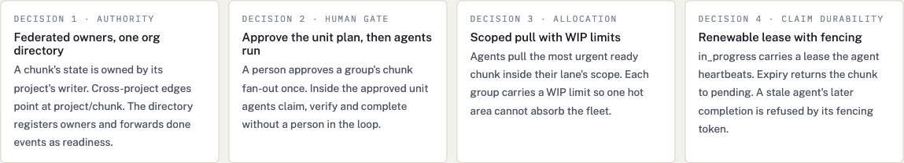

1. **Federated owners and an org directory.** Each project keeps its own owner, lease, gates and receipts. A task may depend on a task in another project. The directory registers owners and relays "done" as readiness. It owns no task and can change nothing.
2. **One human gate per feature.** A person approves a feature's task list once. Inside an approved feature, agents claim, check and finish tasks with no person in the loop.
3. **Scoped pull with limits.** Agents belong to a team bound to one or more features. They take the most urgent ready task inside that scope, and each feature has a limit on how many of its tasks run at once.
4. **Renewable checkouts with fencing.** An agent's claim carries an expiry and a checkout number. Progress reports renew it. When it expires the task returns to the to-do list by itself, and a late submission under the old number is rejected even if its checks pass.

Two further decisions were settled on 1 November 2026:

- **Plan approval lives in native state.** The plan and its approval are native records like every other. A GitHub pull request is one place to review and approve it, the same way Linear issues are one place to read tasks.
- **Documentation lives in the repo and in a shareable doc.** This file is the spec; a shareable copy exists for people outside the codebase.
- **Fleet words everywhere.** Plan, feature, task, team, checkout, request and decision log replace roadmap, group, chunk, lane, signal and think trace on every public surface: the desktop, MCP tool names, the CLI, skills, docs and the website. One glossary owns the mapping and one clean cutover applies it.
- **The desktop adopts this design's visual identity.** Brass for claims, one color and shape per task state, a serif display face with monospace data, and control-room density. The look is chosen from complete editions the owner blesses before any code changes.
- **The desktop opens on "Waiting on you".** Plan approvals, agent questions and stalled holds come first, with their ages and what they block; project progress and team capacity follow.

### Self-hosting the directory

The directory ships inside the binary companies already install, as `magistr directory serve`: one process, SQLite by default, Postgres when configured, token or OIDC sign-in using the existing credential and device-flow code. It speaks the existing unified-record-envelope contract, so a hosted directory and a self-hosted one run identical code. Owners keep working offline and queue events in the existing outbox. A project that never connects behaves exactly as it does today.

### When a person holds a task too long

People do not get an expiring checkout, because taking a task back silently can discard uncommitted work. A person's hold instead has an activity clock fed by progress records, checks and commits on the task branch.

1. Idle past a first threshold, the holder gets a nudge in their own tool.
2. Idle past a second threshold, the hold appears in the approver's "waiting on a person" list with a one-click Release and a count of the tasks it blocks.
3. Thresholds shrink as the number of blocked tasks grows: a task holding up three others escalates in hours, a leaf task in days.
4. Release returns the task to the to-do list, keeps the person's branch and records who released it and why.

Nothing releases a person's task unless another person decides to.

## Task lifecycle

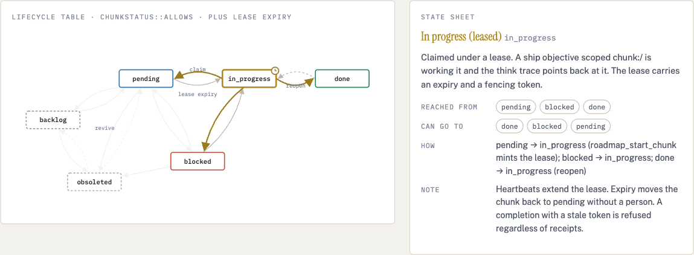

The six states and every legal move come from `ChunkStatus::allows` and do not change. Scale adds one automatic move: an expired agent checkout returns `in_progress` to `pending`. "Ready" stays a derived property, now with five conditions: pending, no recorded blocker, every dependency done including other projects', the feature's plan approved, and the feature under its limit.

## The shared graph

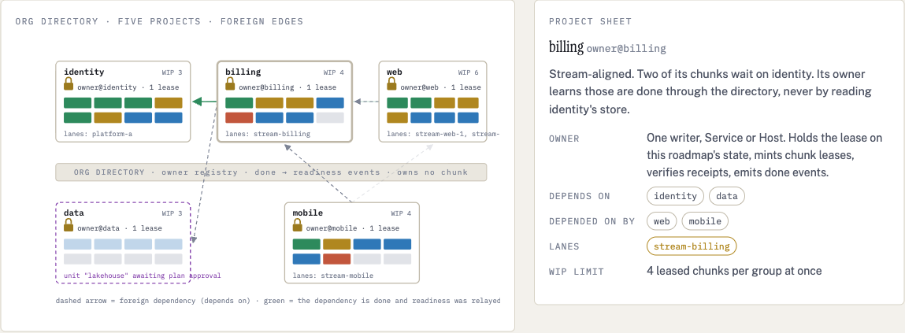

Each project is a region with its own owner. Dashed arrows are dependencies on another project's task; green means the dependency is done and the directory has relayed it. A project waiting on its plan approval is drawn dimmed.

## A claim, end to end

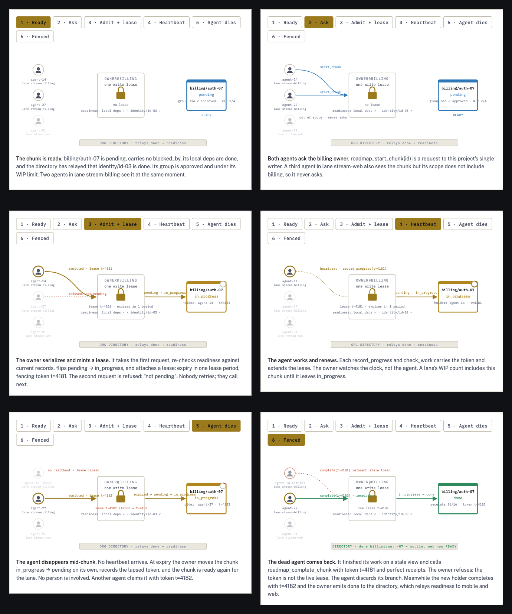

Ready, ask, admit with a checkout, renew by working, crash and expire, and the late submission rejected. An agent outside the team's scope never asks.

## Where people sit

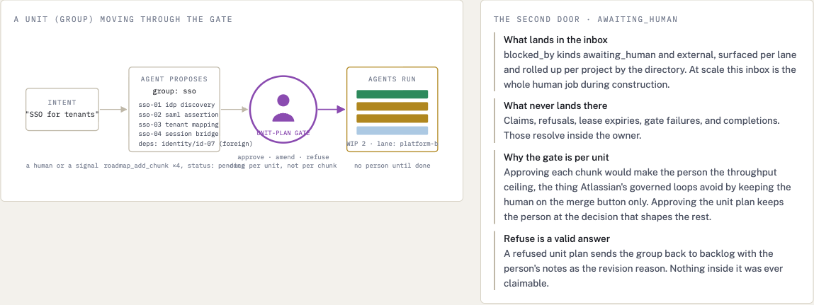

People appear in two places: approving a feature's task list, and answering questions an agent has marked as needing a decision. Claims, refusals, expiries, failed checks and completions never reach a person.

## The whole company

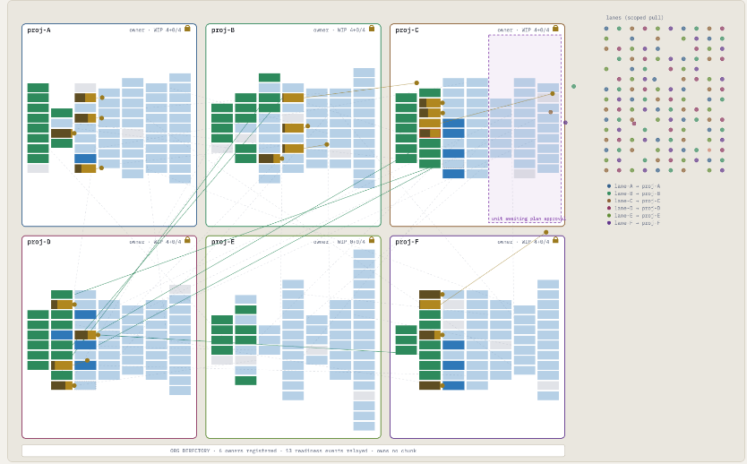

A simulation of all four decisions at once. The lesson it makes visible is that the frontier of ready work, not the number of agents, limits throughput. Adding agents to a narrow graph only adds idle agents.

## A day in each role

Tessaly Freight is a fictional company with nine codebases and 212 agents. One feature, single sign-on for the customer portal, runs through every screen. Nobody at Tessaly opens a Magistr app; Magistr appears inside the tools each role already uses.

### 08:52 · Product manager · Linear triage

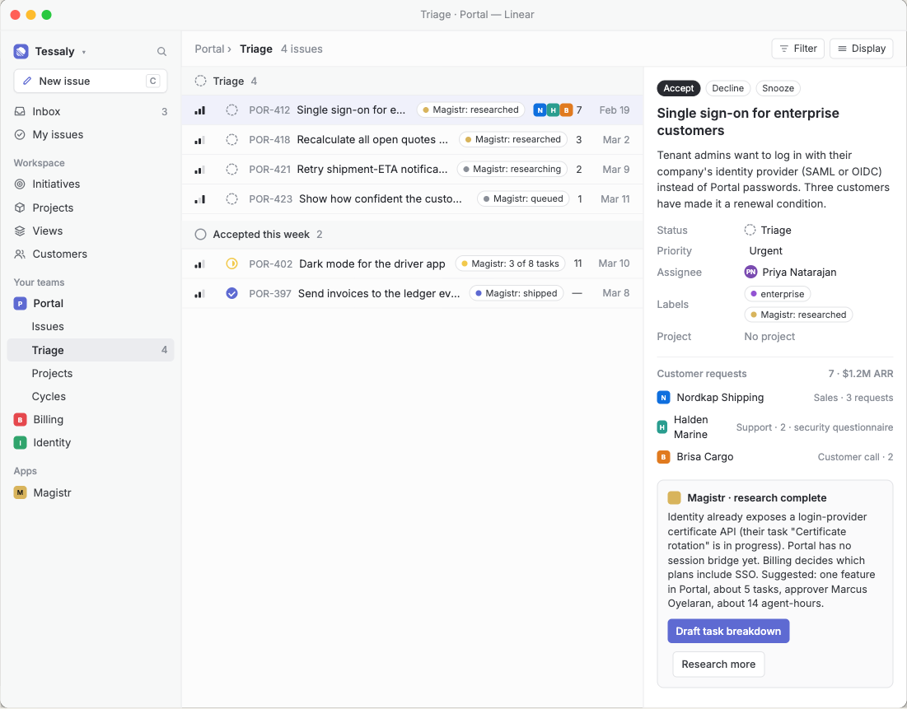

Customer requests attach to issues as they already do. The Magistr app researches each triage item against every codebase and adds a label, a research note and a "Draft task breakdown" action. The research finds cross-team dependencies before anyone plans.

### 09:14 · Tech lead · plan review in GitHub

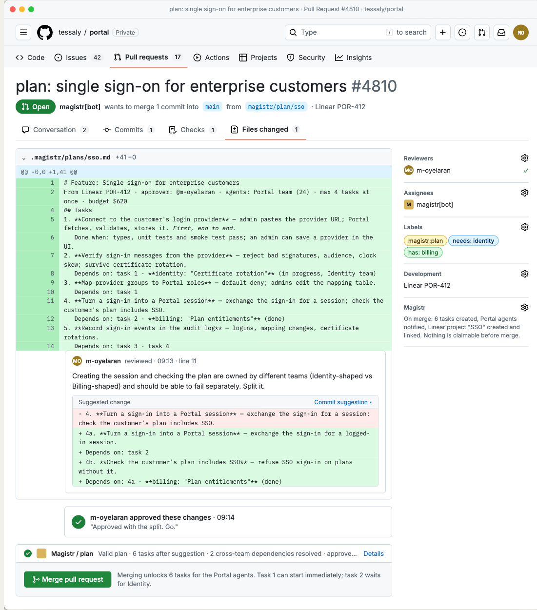

The drafted task list arrives as a pull request projected from the native plan. The tech lead splits one task with a suggested change and approves. The approval is recorded in native state; nothing is claimable before it.

### 09:15 · Agents · session log

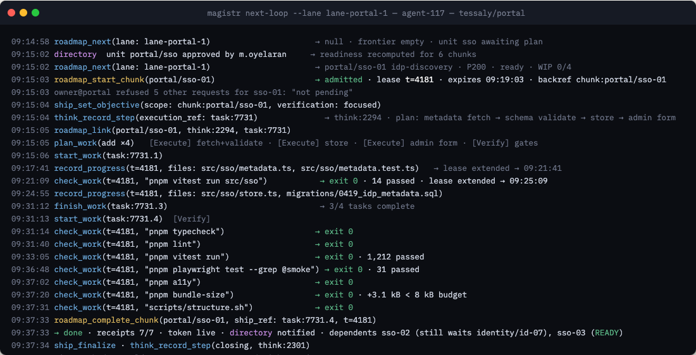

Sixty seconds after approval: six agents ask for the first task, one is admitted with checkout 4181, every progress report and check renews it, seven checks pass, the task completes, and the agent loses the next task by 40 ms and moves on.

### 10:31 · Engineer · VS Code

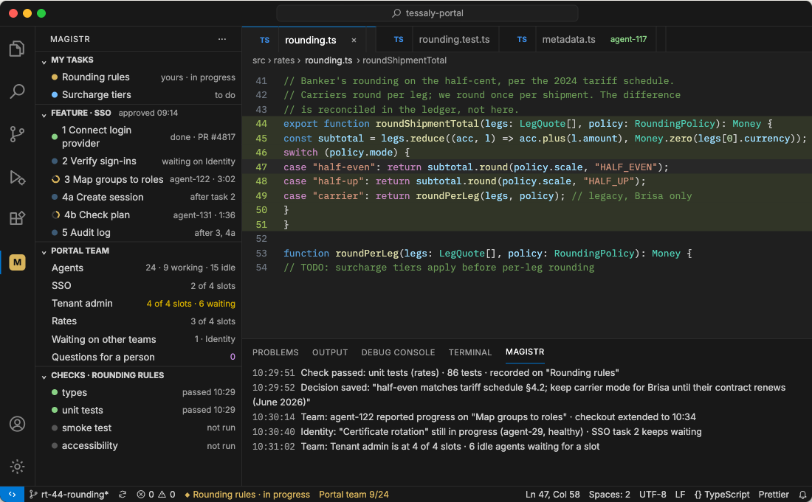

The engineer works on a task nobody gave to an agent. The Magistr extension sits in the activity bar: her tasks, the feature's progress with checkout timers, team capacity and her checks. None of it interrupts her.

### 11:06 · Platform engineer · Grafana

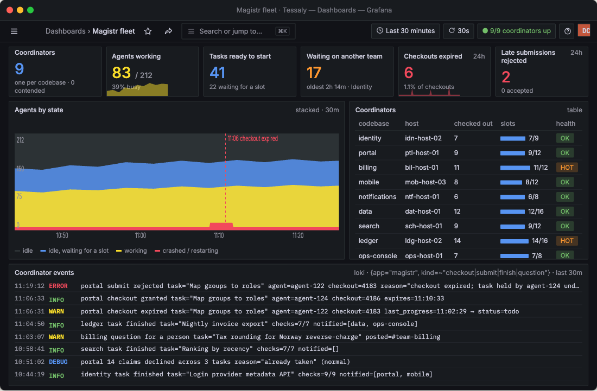

Magistr exports metrics and logs like any service. A crashed agent's checkout expires and the task returns to the to-do list; the agent's late submission is rejected. Both are log lines. Nobody is paged.

### 11:40 · Engineer · Slack

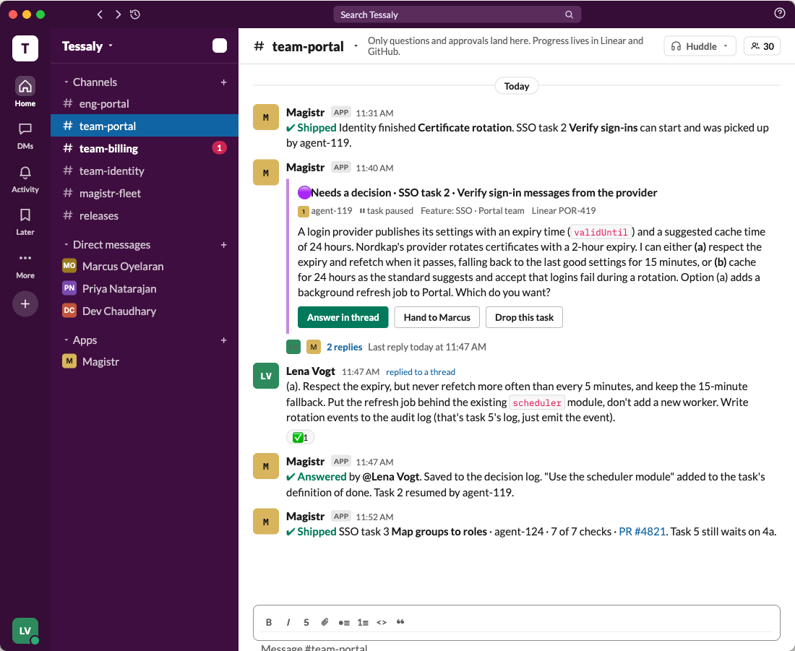

The one question of the day. The agent writes its options into the task; the Magistr app posts it to the team channel. The engineer answers in the thread and the answer becomes part of the task's definition of done.

### 13:15 · Product manager · Linear project

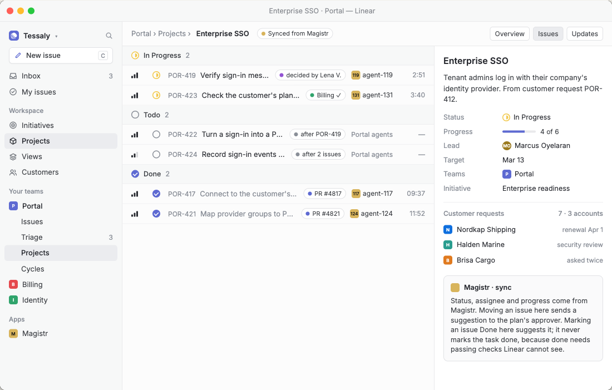

Account managers read the Linear project. Agents are assignees, status flows one way from Magistr, and the customers who asked for the feature stay attached. Marking an issue done in Linear only suggests it, because done needs passing checks.

### 14:02 · Tech lead · task pull request

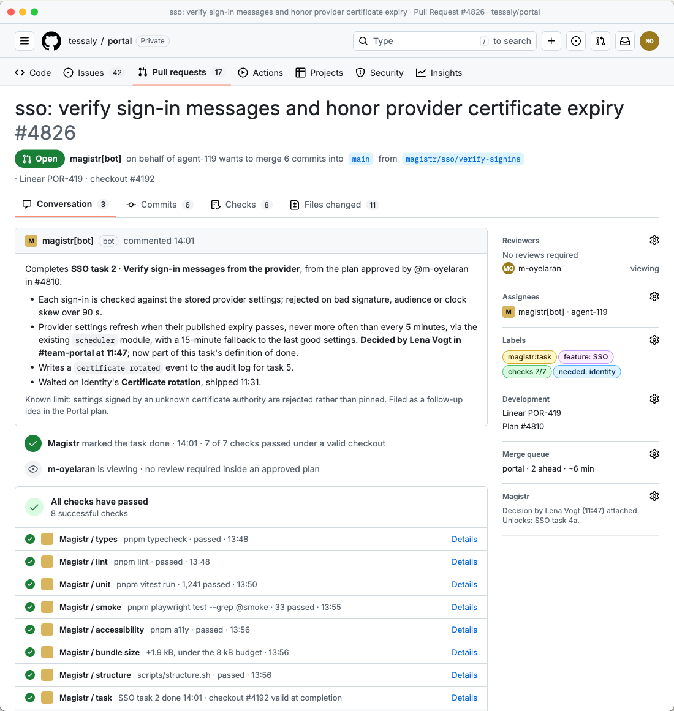

Every Magistr check is a required status check. Inside an approved plan no human review is required; the merge queue takes it. The engineer's Slack decision is quoted in the description because it was attached to the task.

### 16:30 · Director · Linear initiatives

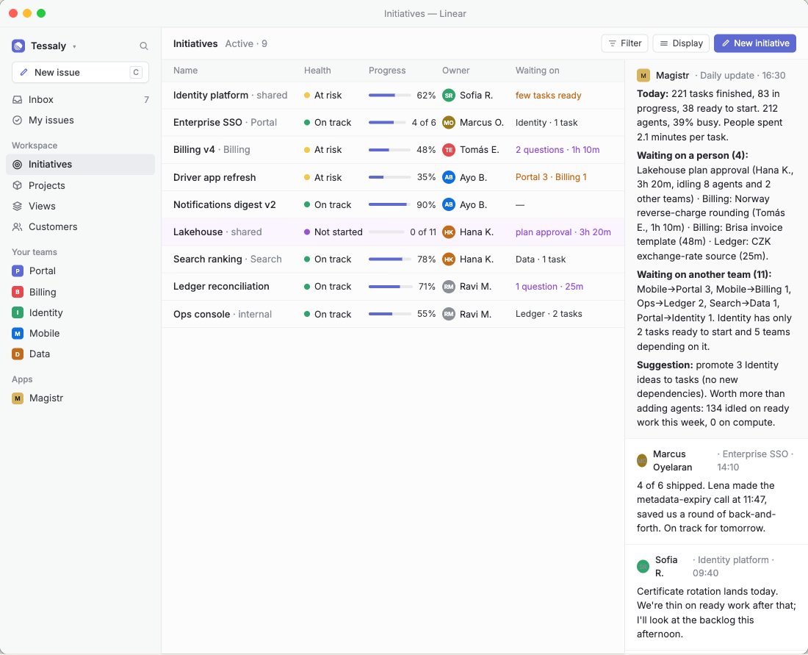

Magistr writes health, progress and a daily update into each initiative. The update is about waiting: four things on a person, eleven on another team, and a suggestion that names who can widen the narrowest queue.

### Friday · CTO · weekly email

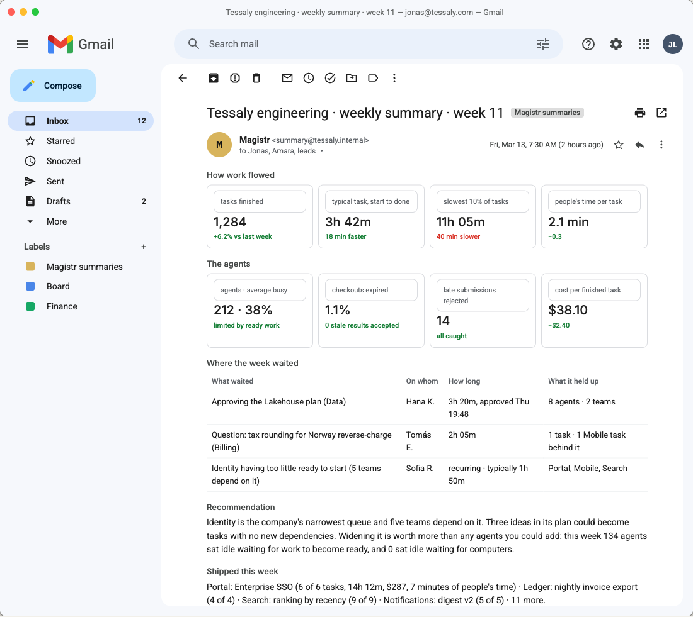

Flow, spend and the three decisions that waited longest. The number that matters for funding: every idle agent-hour was spent waiting on ready work, a slot or a person, none on compute.

## Research

- **AWS AI-Driven Development Lifecycle.** Intent decomposes into units of work run as short bolts; the team approves the decomposition. Maps to features, tasks and the plan gate. [AWS DevOps blog](https://aws.amazon.com/blogs/devops/ai-driven-development-life-cycle), [glossary](https://awslabs.github.io/aidlc-workflows/guide/glossary/).
- **Atlassian, Linear, Factory.** Agents pull unassigned, well-defined work; humans keep one gate. Maps to readiness, teams as assignees and receipts as the merge gate. [Atlassian governed agent loops](https://www.atlassian.com/blog/jira/governed-agent-loops).
- **Beads and Gas Town.** A git-backed graph tracker with a ready queue, limited to one repository. The directory fills the cross-repository gap. [Beads](https://github.com/steveyegge/beads).
- **Queue leases.** Visibility timeouts are holds, not locks; renew on progress and fence stale attempts. Maps to checkouts. [SQS visibility timeouts](https://oneuptime.com/blog/post/2026-07-22-sqs-visibility-timeouts-concurrent-processing/view).
- **Portfolio kanban.** Limit work in progress per state and group; make cross-team waits visible instead of working around them. Maps to feature limits and the "waiting on another team" count. [Portfolio WIP limits](https://businessmap.io/kanban-resources/portfolio-kanban/managing-portfolio-wip-limits).
- **Team Topologies.** Stream-aligned teams consume platform teams as a service. Maps to teams of agents and dependencies on shared projects. [Fowler](https://martinfowler.com/bliki/TeamTopologies.html).

No published account of hundreds of agents across repositories was found; single-repository orchestrators report needing a coordinator at about 20 to 30 agents.

## Delivery

Group "Fleet coordination", in dependency order:

| Chunk | Delivers |
|---|---|
| `fleet-contract` | `docs/architecture/fleet.md`: qualified ids, checkout and fencing protocol, holder kinds, staleness ladder, directory API, self-host topology |
| `roadmap-group-record` | Features as records with state, approver, limit and budget; readiness requires approval |
| `roadmap-plan-approval` | Native plan proposal, amendment, approval and refusal |
| `chunk-claim-lease` | Agent checkouts with expiry and fencing |
| `person-hold-staleness` | Activity clock, nudge, escalation and release for people |
| `lane-scoped-next` | Team-scoped next task with feature limits |
| `cross-project-deps` | Dependencies on another project's task |
| `directory-server` | `magistr directory serve`, self-hostable |
| `owner-directory-client` | Owners register, publish done and receive readiness |
| `fleet-metrics` | Fleet metrics and a Grafana dashboard |
| `fleet-scratch-proof` | End-to-end proof on scratch projects |

Group "Desktop vision", ahead of everything else:

| Chunk | Delivers |
|---|---|
| `vocabulary-glossary` | `docs/reference/vocabulary.md`, the one mapping from internal terms to public words |
| `desktop-identity-design-round` | Complete-catalog desktop editions in this identity, blessed by the owner |
| `vocabulary-cutover` | One rename across desktop, MCP, CLI, skills, docs and site |
| `desktop-identity-cutover` | Tokens, typefaces, density and one state system in the desktop |
| `desktop-waiting-home` | The "Waiting on you" home |
| `desktop-plan-approval` | Reviewing and approving a feature's task list |
| `desktop-checkouts-and-holds` | Holders, checkout timers and stalled holds everywhere tasks appear |
| `desktop-team-capacity` | Team scope, slots and why agents are idle |
| `desktop-company-board` | Every project as a region of one plan |
| `desktop-requests-to-features` | Turning researched requests into drafted features |
| `desktop-answer-questions` | Answering agent questions so the answer becomes the definition of done |

Group "Fleet integrations" holds the product integrations shown above, with this document as their spec. Since 1 November 2026 every fleet, integration and desktop-vision chunk is pending at the top of the plan.
